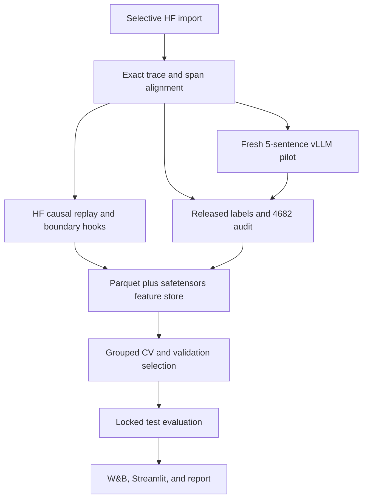

# Implementation specification: pre-emission thought-anchor prediction

The fastest credible MVP is a **replay-first experiment**:

1. Reuse the released Thought Anchors trajectories and counterfactual-importance labels.
2. Replay the exact traces through the exact open-weight 14B model.
3. Extract residual-stream activations immediately before each target sentence.
4. Train problem-grouped layer-wise linear probes against strong observable baselines.
5. Validate the label-generation implementation with one small fresh counterfactual-resampling pilot.
6. Expose results through W&B plus an SSH-forwarded Streamlit trajectory inspector.

This produces a scientifically interpretable result without regenerating roughly half a million expensive rollouts.

This specification operationalises `research/project-brief.md` into a concrete MVP. Where the brief intentionally leaves implementation choices open, this specification freezes those choices for reproducibility. The brief remains authoritative for the research question, estimand and scope. `AGENTS.md` holds the persistent guardrails for the coding agent; this document remains the detailed authority for execution, schemas, commands, stage gates and acceptance criteria.

Cross-check against the brief (2026-09-14): the canonical importance of §3.6 is the brief's KL(P(A | different S_i) ‖ P(A | S_i)); §3.4 implements MVP item 7 (problem-level held-out evaluation); §3.9–3.10 implement MVP items 5–6 (simple predictors first, strong observable baselines); the lead-time-one experiment addresses sub-question 3. Sub-questions 4 and 7 (semantic categories; receiver-head and attention-suppression measures) and cross-domain generalisation (sub-question 6) are deferred to §12.

---

## 1. Research findings that determine the design

The current Thought Anchors paper studies DeepSeek-R1-Distill-Qwen-14B on 20 MATH problems, with one correct and one incorrect trajectory per problem. It reports 48 model layers, temperature 0.6, top-p 0.95, about 144 sentences and 4,208 tokens per trace, and defines sentence importance using the KL divergence between final-answer distributions with and without the sentence, after filtering replacement sentences by semantic similarity. Planning and uncertainty-management sentences tend to be most important. [Thought Anchors v4](https://arxiv.org/html/2506.19143v4)

The paper’s released method requires 100 “without sentence” and 100 “with sentence” continuations per sentence. Across roughly 5,768 sentences, complete regeneration would mean approximately 577,000 long continuations, plausibly 0.5–1.2 billion generated tokens. That is not an MVP.

The OpenAI work affects the scientific framing:

* *An Alien Mind* argues that verbalized reasoning monitoring is becoming less sufficient and explicitly motivates combining CoT and activation monitoring. [An Alien Mind](https://openai.com/index/an-alien-mind/)
* *Accidental Chain-of-Thought Grading* warns that allowing a CoT monitor to influence training reward can incentivize concealment. This project’s probe must therefore remain a **passive, offline observer**, never a reward or fine-tuning signal. [Accidental CoT Grading](https://alignment.openai.com/accidental-cot-grading/)
* *Self-Incrimination* shows that internal or self-generated signals can expose behavior missed by output-only monitoring, while also showing the value of matched output-only baselines. [Self-Incrimination](https://alignment.openai.com/self-incrimination/)
* *Predicting LLM Safety Before Release by Simulating Deployment* shows that realistic replay and especially tool resampling matter for external validity. This math experiment is a construct-validation experiment, not yet a deployment-safety forecast. [Deployment simulation paper](https://arxiv.org/abs/2607.07184)

The coding agent must preserve that distinction in every report.

---

# 2. Codex execution contract

The following rules are enforced by the existing `AGENTS.md` (which Codex must not regenerate) and are summarised here as the execution contract:

1. Implement the listed MVP exactly before adding extensions.
2. Do not alter model, revisions, problem split, anchor threshold, primary metric, or feature timing silently.
3. Any necessary amendment creates `artifacts/amendments/<timestamp>.md`, a new configuration hash, and a new run ID.
4. Never inspect test metrics before `frozen_selection.json` exists.
5. Never use target-sentence tokens or completed-trajectory length in primary pre-emission features.
6. Never use quantization for the primary experiment.
7. Never let the probe or labels enter model training or reward.
8. Preserve every upstream repository unchanged at its pinned commit.
9. Make all expensive stages resumable and content-addressed.
10. Ask the user before changing any frozen scientific choice, before any operation that could destroy persistent data, before any stage whose projected runtime or cost exceeds what the user has authorised, and for missing credentials or identifiers:

* Git repository URL
* existing instance IP
* Lambda SSH key name and persistent-filesystem name
* W&B API key
* secondary backup destination, if required

`AGENTS.md` §13 is authoritative for this list.

---

# 3. Exact MVP

## 3.1 Primary research question

For a reasoning sentence \(S_i\), can the model’s internal state **immediately before emitting any token from \(S_i\)** predict whether \(S_i\) will later have high counterfactual importance for the final answer?

The probe is correlational. It does not establish that the pre-emission representation causes the future sentence to be important.

## 3.2 Model

Use only:

```yaml
model_id: deepseek-ai/DeepSeek-R1-Distill-Qwen-14B
revision: 1df8507178afcc1bef68cd8c393f61a886323761
dtype: bfloat16
quantization: null
context_length: 32768
```

The revision currently contains 14.77B BF16 parameters, approximately 29.54 GB. [Pinned model](https://huggingface.co/deepseek-ai/DeepSeek-R1-Distill-Qwen-14B/tree/1df8507178afcc1bef68cd8c393f61a886323761)

Use the raw Thought Anchors prompt and trace format, not a newly introduced chat template.

## 3.3 Data

Pin:

```yaml
dataset_id: uzaymacar/math-rollouts
dataset_revision: a3a2fe1eb6d52e6ef81860baff018a8df2eb8ae2
```

The released dataset is MIT-licensed but very large as a whole. Fetch only selected files using `HfApi.list_repo_tree` followed by `snapshot_download(..., allow_patterns=...)`; do not call an operation that downloads the entire repository. Hugging Face supports revision pins and pattern-restricted downloads. [Dataset](https://huggingface.co/datasets/uzaymacar/math-rollouts), [download API](https://huggingface.co/docs/huggingface_hub/guides/download)

Use exactly these 20 problem IDs, with both the released correct and incorrect trajectory:

```text
330, 1591, 2050, 2137, 2189, 2236, 2238, 2870, 3360, 3448,
3550, 3916, 3935, 4019, 4164, 4605, 4682, 6481, 6596, 6998
```

Expected total: 40 trajectories and roughly 5,768 sentence rows before eligibility filtering.

## 3.4 Fixed problem-level split

Both trajectories for a problem must always stay together.

| Split      | Problem IDs                                                            | Trajectories |
| ---------- | ---------------------------------------------------------------------- | -----------: |
| Train      | 2238, 1591, 4682, 6596, 3448, 2189, 3550, 4605, 2137, 4019, 3360, 3935 |           24 |
| Validation | 330, 4164, 2050, 6481                                                  |            8 |
| Test       | 6998, 2236, 2870, 3916                                                 |            8 |

Store this in `configs/splits/mvp_20_v1.yaml`. Code must assert that the three problem sets are mutually disjoint.

Because the paper and public artifacts already analyze these problems, call this an **exploratory held-out engineering test**, not a pristine confirmatory test.

## 3.5 Sentence eligibility

A sentence is eligible only when all conditions hold:

* It aligns exactly to one character span in the stored trace.
* Its target token start and preceding boundary token are unambiguous.
* It is not the first token of the trace.
* It is not the final-answer-emission sentence.
* It has the required next fork for the “with sentence” answer distribution.
* It precedes convergence.
* Its importance is finite and nonnegative.

Primary convergence rule:

1. For each fork position, obtain the proportion of continuations producing the correct answer.
2. Convergence begins at the first position where five consecutive forks all have accuracy in `[0, 0.01]` or all have accuracy in `[0.99, 1]`.
3. Exclude that position and everything after it.
4. Record `convergence_source: accuracy_proxy`.

This differs from the paper’s conceptual “same answer in more than 98% of resamples.” Record the mismatch. Run a four-consecutive-fork sensitivity because the pinned repository’s implementation uses behavior equivalent to four in some paths.

## 3.6 Counterfactual label

For sentence \(S_i\):

* `without`: continuations sampled from the prefix ending before \(S_i\), whose first replacement sentence is dissimilar to \(S_i\).
* `with`: continuations sampled from the prefix ending immediately after \(S_i\), without same-fork similar replacements.
* Dissimilarity: cosine similarity below `0.8`.
* Embedding model:

```yaml
similarity_model: sentence-transformers/all-MiniLM-L6-v2
similarity_revision: 1110a243fdf4706b3f48f1d95db1a4f5529b4d41
```

[Pinned embedding model](https://huggingface.co/sentence-transformers/all-MiniLM-L6-v2/tree/1110a243fdf4706b3f48f1d95db1a4f5529b4d41)

The canonical implementation must form the union of normalized answer categories, including `<NO_ANSWER>`, and calculate:

$$
p^-_\alpha(a)=\frac{n^-_a+\alpha}{N^-+\alpha K}, \qquad
p^+_\alpha(a)=\frac{n^+_a+\alpha}{N^++\alpha K}
$$

$$
I_i=\sum_a p^-_\alpha(a)\log \frac{p^-_\alpha(a)}{p^+_\alpha(a)}
$$

Primary \(\alpha=10^{-9}\); sensitivities use `0.5` and `1.0`.

Implement three distinguishable label fields:

* `importance_released`: the released `counterfactual_importance_kl` field.
* `importance_legacy`: exact behavior of the pinned repository.
* `importance_canonical`: the equation above.

The primary replay experiment may use `importance_released` for speed only after the mandatory Problem 4682 audit establishes:

* at least 99% of eligible released values are finite and nonnegative; and
* released labels have Spearman correlation at least 0.95 with either the legacy or canonical recomputation on the fully downloaded Problem 4682 correct trajectory.

If that gate fails, fetch the released raw resamples for all 40 trajectories and recompute canonical labels. Do not change the formula.

## 3.7 Binary anchor construction

The continuous target is:

```text
importance_log1p = log1p(importance_primary)
```

The binary target is:

```text
anchor = importance_primary >= quantile(train_eligible_importance, 0.90)
```

Rules:

* Estimate the threshold from eligible **training sentences only**.
* Freeze it in `frozen_selection.json`.
* Apply the same numeric threshold to validation and test.
* Sensitivities use training quantiles 0.80 and 0.95.
* Do not define test anchors using a test-set quantile.

## 3.8 Pre-emission boundary and activations

For an exact target character span `[char_start, char_end)`:

```python
target_token_start = min(
    k for k, (_, offset_end) in enumerate(offset_mapping)
    if offset_end > char_start
)
boundary_token_idx = target_token_start - 1
```

A token whose span overlaps `char_start` belongs to the target sentence and must not enter the prefix.

Tokenize the exact stored full trace once, using the pinned tokenizer and the same explicit-special-token behavior as the upstream generation. Save token IDs and offset mappings. Do not reconstruct the trace by joining normalized sentences.

Run the full trace causally and retain only the selected boundary rows. Register hooks on:

* embedding output: stored as `layer=0`;
* each of the 48 decoder-block outputs, before the final RMSNorm: stored as `layer=1..48`.

Store shape:

```text
[number_of_sentences, 49, 5120]
```

Use BF16 during inference and FP16 in the stored safetensors. The paper’s zero-indexed final layer 47 corresponds to stored `layer=48`.

Do not use `output_hidden_states=True` for the production pass because it retains every token at every layer. Transformers supports hidden-state outputs, but boundary-selective hooks are materially more memory efficient. [Transformers model outputs](https://huggingface.co/docs/transformers/main_classes/output)

## 3.9 Strict pre-emission observable features

The primary observable baseline may use only information available at the boundary:

* `sentence_idx`
* generated token count since the start of `<think>`
* total prefix token count
* `log1p(prefix_token_count)`
* `prefix_token_count / 32768`
* previous sentence token length
* previous emitted token log-probability
* next-token entropy
* next-token maximum probability
* top-1 minus top-2 probability margin
* top-5 probability mass
* top-10 probability mass

Compute next-token statistics by applying final RMSNorm and `lm_head` to stored final-layer boundary states in batches. Do not store full-vocabulary logits.

Exclude from the primary model:

* the target sentence’s text;
* any token from the target sentence;
* the probability assigned to the actual first target token;
* sentence position divided by final trajectory length;
* final trajectory length;
* correctness of the eventual answer;
* later hidden states.

Store these excluded quantities as explicitly marked diagnostic fields where useful:

```text
diagnostic__first_target_token_logprob
diagnostic__relative_completed_trace_position
```

## 3.10 Models and baselines

Train the following:

| Name                            | Inputs                                                        |
| ------------------------------- | ------------------------------------------------------------- |
| Prevalence                      | Training anchor rate                                          |
| Position                        | Sentence index and prefix-position fields                     |
| Context                         | Prefix length and previous-sentence length                    |
| Uncertainty                     | Log-probability, entropy, margin, top-k mass                  |
| Observable combined             | Position + context + uncertainty                              |
| Activation L0…L48               | One residual layer at a time                                  |
| Activation + observables L0…L48 | Residual layer concatenated with combined observables         |
| Residualized activation         | Selected layer after fold-local linear removal of observables |

Probe definitions:

* `StandardScaler` fit on training folds only.
* Binary: L2 logistic regression with `class_weight="balanced"` and `max_iter=5000`.
* `C ∈ [1e-4, 1e-3, 1e-2, 1e-1, 1, 10, 100]`.
* Continuous: Ridge regression on `log1p(importance)`.
* `alpha ∈ [1e-4, 1e-3, 1e-2, 1e-1, 1, 10, 100, 1e3, 1e4]`.
* Four-fold `StratifiedGroupKFold`, shuffled with the root seed, grouped by `problem_id`. Group-aware CV prevents the same problem entering train and validation folds. [scikit-learn grouped CV](https://scikit-learn.org/stable/modules/cross_validation.html#group-k-fold)

Selection:

1. Select binary layer and `C` using mean train-CV AUCPR.
2. Select Ridge layer and alpha using train-CV Spearman, with RMSE as tie-breaker.
3. Fit selected probes on all training data.
4. Fit a Platt scaling model on validation scores only.
5. Skip calibration and record the reason if validation has fewer than 20 positives or only one class.
6. Freeze selection before test evaluation.

## 3.11 Metrics

Primary:

* test AUCPR for the selected activation+observable probe.

Secondary:

* AUROC
* Brier score
* log loss
* 10-bin equal-frequency expected calibration error
* reliability curve
* continuous-label Spearman correlation
* continuous RMSE
* per-trajectory Precision@top-10%
* per-trajectory NDCG@top-10%
* AUCPR gain over combined observables
* paired metric differences between models

Use a 2,000-replicate paired bootstrap resampling test problem IDs with replacement, keeping both trajectories and all their sentences together. With only four test problems, intervals are descriptive; do not make strong significance claims.

## 3.12 Minimum experiment set

1. **Released-label replay:** all eligible sentences, all 49 activation sites, lead time zero.
2. **All observable baselines.**
3. **Activation-only and activation-plus-observable probes at all layers.**
4. **Selected-layer residualized-activation control.**
5. **Lead time one:** predict \(S_i\) using the boundary immediately before \(S_{i-1}\), selected layer only.
6. **Threshold sensitivities:** train quantiles 0.80, 0.90, 0.95.
7. **Convergence sensitivities:** four versus five consecutive extreme-accuracy forks.
8. **Replacement-quality sensitivity:** require dissimilar replacement fraction at least 0.10 or at least ten dissimilar released rollouts.
9. **Correct versus incorrect trajectory subgroups.**
10. **Position and entropy quintile stratification.**
11. **One hundred label permutations within `(problem_id, trace_kind, position_quintile)` on the selected layer.
12. **Fresh Problem 4682 resampling pilot.**

## 3.13 Fresh counterfactual pilot

Use the released correct trajectory for Problem 4682.

Targets are the released source chunks corresponding by text to paper display sentences:

```text
6, 12, 13, 14, 46
```

Do not assume whether paper display numbering is zero- or one-based. During import:

1. Compare the paper transcript, released `source_chunk_idx`, and interface numbering.
2. Match by exact normalized text.
3. Store the resulting zero-based IDs and text SHA-256 values in `configs/pilot_targets_4682.yaml`.
4. Stop if any target is ambiguous.

Generate 32 continuations for every unique required fork: target fork \(i\) and with-sentence fork \(i+1\). Adjacent targets share fork data. Expect approximately 256 completions.

Use:

```yaml
temperature: 0.6
top_p: 0.95
max_new_tokens: 16384
seed_root: 20260914
```

Derive each sample seed from:

```python
uint32(sha256(f"{seed_root}:{trajectory_id}:{fork_idx}:{sample_idx}")[:8])
```

Require at least ten semantically dissimilar “without” samples per target. If a target fails, extend only that fork from 32 to 100 samples. Unsupported targets remain labeled `low_counterfactual_support`; do not silently drop them.

This pilot validates mechanics and estimand construction. It is not powered to replicate the paper’s rankings exactly.

---

# 4. Existing code to reuse

Pin the main repository as a read-only submodule:

```text
https://github.com/interp-reasoning/thought-anchors
commit b53ed8c75d3f6112f68adfaec9a13d4d708c442e
```

[Main repository](https://github.com/interp-reasoning/thought-anchors/tree/b53ed8c75d3f6112f68adfaec9a13d4d708c442e)

Pin the interface repository for reference:

```text
https://github.com/interp-reasoning/thought-anchors.com
commit 67071a30bd2173c56f1772a26f6a9e6855170035
```

[Interface repository](https://github.com/interp-reasoning/thought-anchors.com/tree/67071a30bd2173c56f1772a26f6a9e6855170035)

Before copying source rather than wrapping it, verify each repository’s license and retain its notices. If a permissive license is absent, independently reimplement the small required routines.

| Upstream component                                            | Disposition                                                               | Reason                                                                                                                                    |
| ------------------------------------------------------------- | ------------------------------------------------------------------------- | ----------------------------------------------------------------------------------------------------------------------------------------- |
| `generate_rollouts.py`                                        | Inspect and wrap prompt/sampling semantics; reimplement job orchestration | Its local Transformers path is slow; resume is coarse; sentence removal uses text replacement; API seeding is disabled in the pinned path |
| `analyze_rollouts.py`                                         | Preserve as legacy audit; reimplement canonical importance                | Pinned behavior includes smoothing reassignment, counterintuitive CLI flag behavior, and optional pooling of same-fork similar samples    |
| `utils.py::split_solution_into_chunks`                        | Port verbatim as `upstream_v1`; separately implement `span_v2`            | Needed for parity, but the final-fragment path is commented out and range alignment is fuzzy                                              |
| Answer extraction and normalization helpers                   | Wrap or port with attribution and golden tests                            | Matching boxed-answer normalization is essential                                                                                          |
| `step_attribution.py`                                         | Reference only                                                            | It measures later sentence matching, not pre-emission prediction                                                                          |
| `plots.py`, `sentence_scatter_and_ttests.py`                  | Reference analysis definitions only                                       | New plots must read normalized artifacts                                                                                                  |
| `whitebox-analyses/pytorch_models/model_loader.py`            | Reference model/module layout                                             | Avoid its default precision and architecture coupling                                                                                     |
| `whitebox-analyses/pytorch_models/hooks.py`                   | Reference hook locations                                                  | Implement a smaller boundary-only extractor                                                                                               |
| `whitebox-analyses/attention_analysis/receiver_head_funcs.py` | Later extension                                                           | Receiver-head analysis is not necessary for the MVP                                                                                       |
| Interface `ProblemVisualizer.js` and `ChainOfThought.js`      | Reuse interaction ideas and field names                                   | Streamlit is faster than adapting hard-coded Next.js imports                                                                              |
| Interface `AttributionGraph.js`                               | Later compatibility target                                                | Export `step_importance.json`, but do not make the interface a blocking dependency                                                        |
| Released dataset                                              | Reuse unchanged                                                           | Primary fast path for trajectories and labels                                                                                             |

Create `docs/upstream_audit.md` documenting:

* paper equation;
* released field;
* pinned repository behavior;
* canonical behavior;
* all observed differences;
* which field became `importance_primary`.

Never patch the submodules.

---

# 5. System architecture



Generation and activation extraction must use separate processes and not hold two copies of the 14B model simultaneously.

## Stage interfaces

### Trajectories

One row per correct or incorrect trace:

```text
schema_version
trajectory_id              # e.g. "4682:correct"
problem_id
trace_kind                 # correct | incorrect
problem_text
ground_truth_answer
prompt
solution
full_cot
full_cot_sha256
normalized_final_answer
is_correct
source_path
source_revision
n_chars
n_tokens
```

### Sentences

```text
schema_version
sentence_id                # trajectory_id + sentence_idx
trajectory_id
problem_id
trace_kind
sentence_idx
text
text_sha256
char_start
char_end
token_start
token_end
boundary_token_idx
prefix_token_count
previous_sentence_tokens
alignment_method
alignment_ok
fork_accuracy
dissimilar_fraction
convergence_idx
convergence_source
eligible
exclusion_reason
importance_released
importance_legacy
importance_canonical
importance_primary
importance_log1p
anchor_threshold
anchor_y
label_source
```

### Resamples

```text
schema_version
rollout_id
trajectory_id
target_sentence_idx
fork_idx
condition                   # without | with
sample_idx
seed
prompt_sha256
prompt_token_count
output_path
output_sha256
first_sentence
similarity
is_dissimilar
raw_boxed_answer
normalized_answer
is_correct
finish_reason
generated_tokens
runtime_seconds
backend
backend_digest
status
```

### Activation index

```text
schema_version
sentence_id
trajectory_id
shard_path
row_idx
n_layers                    # 49
d_model                     # 5120
dtype                       # float16
activation_site             # block_post_pre_final_norm
final_prev_position_available   # false when boundary_token_idx - 1 < 0
model_id
model_revision
tokenizer_revision
trace_sha256
token_ids_sha256
```

Each trajectory safetensors file contains:

```text
resid: [n_sentences, 49, 5120]
final_prev_position: [n_sentences, 5120]
```

`final_prev_position` is the `layer=48` state at `boundary_token_idx − 1` (one token earlier than the boundary), stored for the lead-time and boundary-sensitivity analyses. It is absent (NaN row, flagged in the activation index) when `boundary_token_idx − 1 < 0`. It is a diagnostic field and never enters the primary feature schema.

### Predictions

```text
schema_version
sentence_id
problem_id
trajectory_id
split
lead_sentences
threshold_quantile
layer
probe_name
y_true
importance_true
score_raw
probability
probability_calibrated
importance_predicted
```

Every table is Parquet with a sidecar JSON schema and SHA-256 checksum.

---

# 6. Repository design

```text
.
├── AGENTS.md
├── README.md
├── Makefile
├── pyproject.toml
├── uv.lock
├── .env.example
├── .gitignore
├── configs/
│   ├── mvp.yaml
│   ├── pilot.yaml
│   ├── smoke.yaml
│   ├── pilot_targets_4682.yaml
│   ├── splits/
│   │   └── mvp_20_v1.yaml
│   ├── locks/
│   │   ├── upstream.yaml
│   │   └── dataset_files.txt
│   └── lambda/
│       ├── h100_pcie_80.yaml
│       ├── a6000_48.yaml
│       └── a100_40.yaml
├── vendor/
│   ├── thought-anchors/
│   └── thought-anchors.com/
├── docs/
│   ├── methodology.md
│   ├── upstream_audit.md
│   ├── data_dictionary.md
│   ├── lambda_runbook.md
│   ├── test_lock_protocol.md
│   ├── decisions.md
│   ├── alternative_explanations.md
│   └── environment_deviations.md
├── src/preanchor/
│   ├── cli.py
│   ├── config.py
│   ├── manifest.py
│   ├── ids.py
│   ├── io.py
│   ├── logging.py
│   ├── data/
│   │   ├── fetch.py
│   │   ├── schemas.py
│   │   ├── importer.py
│   │   ├── segment.py
│   │   ├── align.py
│   │   └── answers.py
│   ├── labels/
│   │   ├── generate.py
│   │   ├── similarity.py
│   │   ├── importance.py
│   │   ├── convergence.py
│   │   └── audit.py
│   ├── model/
│   │   ├── load.py
│   │   ├── boundaries.py
│   │   ├── hooks.py
│   │   └── logits.py
│   ├── features/
│   │   ├── extract.py
│   │   ├── observables.py
│   │   └── store.py
│   ├── probes/
│   │   ├── splits.py
│   │   ├── train.py
│   │   ├── calibrate.py
│   │   ├── metrics.py
│   │   ├── bootstrap.py
│   │   └── permutation.py
│   └── viz/
│       ├── plots.py
│       └── exports.py
├── apps/
│   ├── streamlit_app.py
│   └── pages/
│       ├── overview.py
│       ├── trajectories.py
│       ├── metrics.py
│       ├── layers.py
│       └── lead_time.py
├── scripts/
│   ├── bootstrap_lambda.sh
│   ├── start_vllm.sh
│   ├── stop_vllm.sh
│   ├── run_mvp.sh
│   ├── resume_mvp.sh
│   ├── backup.sh
│   ├── pull_artifacts.sh
│   └── ssh_tunnel.sh
├── tests/
│   ├── fixtures/
│   ├── unit/
│   ├── integration/
│   └── scientific/
├── data/                       # ignored
│   ├── raw/
│   ├── interim/
│   └── processed/
├── cache/                      # ignored
├── logs/                       # ignored
├── artifacts/                  # ignored
│   └── runs/<run_id>/
└── reports/
```

Do not put scientific logic exclusively in notebooks.

## Configuration

Use Pydantic settings plus YAML. Avoid Hydra for this small project.

`configs/mvp.yaml` must contain every scientific choice, including:

```yaml
schema_version: 1
seed_root: 20260914

model:
  id: deepseek-ai/DeepSeek-R1-Distill-Qwen-14B
  revision: 1df8507178afcc1bef68cd8c393f61a886323761
  dtype: bfloat16
  context_length: 32768
  attention_implementation: sdpa

dataset:
  id: uzaymacar/math-rollouts
  revision: a3a2fe1eb6d52e6ef81860baff018a8df2eb8ae2
  split_manifest: configs/splits/mvp_20_v1.yaml

segmentation:
  primary: released_chunks
  parity_implementation: upstream_v1
  future_implementation: span_v2
  require_exact_alignment: true

labels:
  primary_field: importance_released
  similarity_threshold: 0.8
  smoothing_alpha: 1.0e-9
  binary_train_quantile: 0.90
  convergence_consecutive: 5
  exclude_final_answer: true

features:
  layers: [0, 1, 2, "...", 48]
  activation_dtype: float16
  leads: [0, 1]
  prohibit_future_features: true

probes:
  logistic_C: [1.0e-4, 1.0e-3, 1.0e-2, 1.0e-1, 1, 10, 100]
  ridge_alpha: [1.0e-4, 1.0e-3, 1.0e-2, 1.0e-1, 1, 10, 100, 1000, 10000]
  cv_folds: 4
  group_column: problem_id
  selection_metric: average_precision

evaluation:
  primary_metric: average_precision
  bootstrap_replicates: 2000
  ece_bins: 10
  test_locked: true

tracking:
  wandb_project: preanchor-mvp
  wandb_mode: online
  streamlit_port: 8501
```

Save the fully resolved configuration under every run.

## Environment lock

Start with Python 3.11 and this compatibility-oriented lock:

```text
torch==2.7.0, CUDA 12.6 wheel
transformers==4.53.2
accelerate==1.8.1
huggingface-hub==0.33.4
sentence-transformers==5.0.0
safetensors==0.5.3
numpy==2.2.6
scipy==1.16.0
pandas==2.3.1
pyarrow==20.0.0
scikit-learn==1.7.1
joblib
pydantic==2.11.7
PyYAML==6.0.2
orjson==3.10.18
typer==0.16.0
rich==14.0.0
tenacity==9.1.2
httpx
wandb==0.21.0
streamlit==1.46.1
plotly==6.2.0
kaleido
pytest==8.4.1
ruff
```

PyTorch’s official installer lists CUDA 12.6 as a supported binary target. [PyTorch installation](https://pytorch.org/get-started/locally/)

`uv.lock` is the final authority. If the proposed lock fails on the actual Lambda image, change only the incompatible packages, rerun smoke tests, and record the original and replacement lock hashes.

## Run contents

Each `artifacts/runs/<run_id>/` contains:

```text
manifest.json
resolved_config.yaml
git.patch
environment/
stages/
data/
activations/
probe_models/
predictions/
metrics/
figures/
trajectory_exports/
logs/
heartbeat.json
failure.json             # only on failure
SUCCESS.json             # only after all gates
SAFE_TO_TERMINATE        # only after backup verification
```

The manifest records:

* run ID, UTC start time, git SHA, dirty-diff hash;
* resolved configuration and hash;
* model, tokenizer, embedding, dataset and upstream revisions;
* `uv.lock` hash and package freeze;
* OS, Python, CUDA, driver, PyTorch and GPU information;
* vLLM image tag and digest;
* input/output file hashes;
* all random seeds;
* exact commands;
* stage states and timings;
* W&B run URL;
* backup destinations and verification status.

---

# 7. Lambda Cloud deployment

## 7.1 Instance choice

Recommended: **one H100 PCIe 80 GB**.

Minimum viable alternative: **one A6000 48 GB**, with generation concurrency one and activation batch size one.

Admissible after a measured fit test: **one A100 40 GB** (SXM4 or PCIe), with generation concurrency one and activation batch size one, using `configs/lambda/a100_40.yaml`:

- `--max-num-seqs 1`
- `--gpu-memory-utilization 0.92`
- `--max-model-len 20480` (prompt plus the 16,384-token pilot budget)

Rationale: BF16 weights ≈ 29.5 GB; the KV cache for this architecture is 2 × 48 layers × 8 KV heads × 128 × 2 B ≈ 0.19 MB per token, so one 20k-token sequence needs ≈ 3.9 GB, which leaves room for exactly one in-flight request. Expect the 256-completion pilot to take several times longer than on an H100; `pilot-labels --benchmark-only 8` decides whether to proceed. Hardware admission is by measurement (the Stage 6 smoke extraction and the pilot benchmark), not by this table.

Dated observation, 2026-09-14; query live prices before launch. Lambda listed approximately:

| Instance  |  VRAM | Price/GPU-hour |
| --------- | ----: | -------------: |
| H100 PCIe | 80 GB |          $3.29 |
| H100 SXM  | 80 GB |          $4.29 |
| A100 PCIe | 40 GB |          $1.99 |
| A6000     | 48 GB |          $1.09 |
| GH200     | 96 GB |          $2.29 |

The GH200 uses an ARM host, so avoid it for the MVP unless the complete dependency lock is first verified on ARM. [Lambda instance pricing](https://lambda.ai/instances), [Lambda instance documentation](https://docs.lambda.ai/public-cloud/on-demand/)

## 7.2 Persistent storage

Create or attach a persistent filesystem in the same region and workspace as the instance. Lambda filesystems are attached during instance creation and mounted at:

```text
/lambda/nfs/<FILESYSTEM_NAME>
```

The root volume is not the authoritative location for data or results. [Lambda storage documentation](https://docs.lambda.ai/public-cloud/on-demand/)

Allocate at least 200 GB initially.

Set:

```bash
export PREANCHOR_ROOT=/lambda/nfs/<FILESYSTEM_NAME>/preanchor
export HF_HOME=$PREANCHOR_ROOT/cache/huggingface
export WANDB_DIR=$PREANCHOR_ROOT/wandb
export PREANCHOR_ARTIFACTS=$PREANCHOR_ROOT/artifacts
```

`bootstrap_lambda.sh` must refuse production execution if `PREANCHOR_ROOT` is not under `/lambda/nfs/`, unless `--allow-ephemeral-dev` is explicitly passed.

## 7.3 Provisioning

Lambda provisioning is manual for the MVP: launch one instance through the Lambda console with the persistent filesystem attached at creation (the console makes the attachment visible). Document the required instance configuration, region, filesystem and firewall settings in `docs/lambda_runbook.md`. Automated provisioning is later work (§12). The coding agent never launches, resizes or terminates infrastructure.

## 7.4 Fresh-instance setup

```bash
nvidia-smi

sudo apt-get update
sudo apt-get install -y \
  git git-lfs jq rsync rclone tmux nvtop build-essential

curl -LsSf https://astral.sh/uv/install.sh | sh

git clone --recurse-submodules <YOUR_REPOSITORY_URL> preanchor
cd preanchor

uv python install 3.11
uv sync --frozen --extra gpu --group dev

cp .env.example .env
chmod 600 .env

export PREANCHOR_ROOT=/lambda/nfs/<FILESYSTEM_NAME>/preanchor
export HF_HOME=$PREANCHOR_ROOT/cache/huggingface
export WANDB_DIR=$PREANCHOR_ROOT/wandb

mkdir -p \
  "$PREANCHOR_ROOT/cache/huggingface" \
  "$PREANCHOR_ROOT/data" \
  "$PREANCHOR_ROOT/artifacts" \
  "$PREANCHOR_ROOT/logs" \
  "$PREANCHOR_ROOT/wandb"

uv run preanchor doctor --config configs/mvp.yaml
uv run pytest -q tests/unit tests/integration
```

`doctor` must verify:

* CUDA visible;
* BF16 support;
* at least 38 GB VRAM; the Stage 6 smoke extraction is the fit test;
* the CUDA driver on the image supports the pinned torch CUDA 12.6 wheel;
* model revision resolves;
* NFS is writable;
* at least 100 GB free;
* W&B authentication or offline fallback;
* no ports other than SSH are required;
* upstream submodules are at exact commits;
* configuration and code are mutually compatible.

## 7.5 vLLM generation service

Use vLLM only for counterfactual generation. Current vLLM supports continuous batching and automatic prefix caching; prefix caching reduces shared-prefix prefill work but not decoding cost. [vLLM](https://docs.vllm.ai/), [automatic prefix caching](https://docs.vllm.ai/en/latest/features/automatic_prefix_caching/)

Start with the current pinned stable image:

```bash
export VLLM_IMAGE=vllm/vllm-openai:v0.28.0

sudo docker pull "$VLLM_IMAGE"
sudo docker image inspect \
  --format='{{index .RepoDigests 0}}' \
  "$VLLM_IMAGE" \
  > "$PREANCHOR_ROOT/artifacts/vllm-image-digest.txt"

sudo docker run --rm --gpus all --ipc=host \
  -p 127.0.0.1:8000:8000 \
  -v "$HF_HOME:/root/.cache/huggingface" \
  "$VLLM_IMAGE" \
  --model deepseek-ai/DeepSeek-R1-Distill-Qwen-14B \
  --revision 1df8507178afcc1bef68cd8c393f61a886323761 \
  --dtype bfloat16 \
  --max-model-len 32768 \
  --enable-prefix-caching \
  --gpu-memory-utilization 0.90 \
  --max-num-seqs 4 \
  --seed 20260914
```

For A6000 (`configs/lambda/a6000_48.yaml`):

```text
--max-num-seqs 1
--gpu-memory-utilization 0.92
```

For A100 40 GB (`configs/lambda/a100_40.yaml`):

```text
--max-num-seqs 1
--gpu-memory-utilization 0.92
--max-model-len 20480
```

`start_vllm.sh` reads these overrides from the selected `configs/lambda/*.yaml` profile; the H100 values above are the `h100_pcie_80.yaml` defaults.

Bind only to localhost. Do not open port 8000 publicly.

Start it through:

```bash
tmux new-session -d -s vllm \
  'cd preanchor && bash scripts/start_vllm.sh configs/pilot.yaml'

curl --fail http://127.0.0.1:8000/health
```

The generator sends individually seeded requests with at most four in flight on H100 and one in flight on A6000 or A100 40 GB. Each completion is written atomically as soon as it finishes.

Stop vLLM and verify GPU memory is released before activation extraction:

```bash
bash scripts/stop_vllm.sh
nvidia-smi
```

## 7.6 Launching and resuming

```bash
tmux new-session -d -s preanchor \
  'cd preanchor && bash scripts/run_mvp.sh configs/mvp.yaml'

uv run preanchor status --root "$PREANCHOR_ROOT"
```

Resume:

```bash
tmux new-session -d -s preanchor-resume \
  'cd preanchor && bash scripts/resume_mvp.sh configs/mvp.yaml'
```

Resume logic must:

* compare config, code and input hashes;
* refuse to mix incompatible runs;
* validate every completed part’s checksum;
* skip valid completed parts;
* quarantine corrupt or partial files;
* rerun only missing work.

## 7.7 Backup and termination safety

Use NFS as the primary durable copy and either an object store or the MacBook as a verified second copy.

Object-store route:

```bash
export PREANCHOR_BACKUP_REMOTE=<RCLONE_REMOTE>:preanchor

bash scripts/backup.sh "$RUN_ID"

rclone check \
  "$PREANCHOR_ROOT/artifacts/runs/$RUN_ID" \
  "$PREANCHOR_BACKUP_REMOTE/runs/$RUN_ID"
```

Back up:

* resolved configurations;
* manifests;
* processed Parquet files;
* activation index and required activation shards;
* probe models;
* predictions;
* metrics;
* figures;
* reports;
* logs;
* fresh resamples.

Do not back up model caches or secrets.

Run backup after every major stage and every 15 minutes while generation is active. Create `SAFE_TO_TERMINATE` only after:

* all stage checksums validate on NFS;
* the secondary-copy verification succeeds;
* W&B has synced or its offline directory is included in the backup.

Never auto-terminate the instance. The human terminates the instance from the Lambda console after `SAFE_TO_TERMINATE` exists and verifies termination in the console; a Linux shutdown does not end billing.

---

# 8. MacBook observability

Use only:

1. **W&B** for live status, system telemetry, configuration, scalar metrics, plots, and failure alerts.
2. **Streamlit over SSH forwarding** for complete trace inspection.
3. **JSONL logs and `preanchor status`** as the durable fallback.

W&B automatically captures GPU/CPU utilization, network metrics and stdout/stderr and supports configurations, tables and artifacts. [W&B logging documentation](https://docs.wandb.ai/models/track/log)

Do not add TensorBoard, Prometheus, Grafana, a database service, or Kubernetes.

## 8.1 W&B contents

Create one parent run for the MVP, with stage jobs grouped under its run group.

Log:

* stage state, total items, completed items, failures, retry count and ETA;
* completions per second and generated tokens per second;
* GPU utilization, memory and temperature;
* CPU/RAM/disk utilization;
* resolved configuration;
* source and dependency revisions;
* label distribution and eligibility counts;
* CV metrics by layer;
* selected layer and regularization;
* validation calibration;
* test metrics and clustered intervals;
* sensitivity and permutation summaries;
* links to local Streamlit run IDs.

Upload only compact artifacts:

* manifests;
* Parquet metadata or sampled tables;
* predictions;
* metrics;
* figures;
* reports.

Do not upload multi-gigabyte raw activations to W&B.

If W&B is unavailable:

```bash
export WANDB_MODE=offline
```

Continue locally, then run:

```bash
wandb sync "$WANDB_DIR"/wandb/offline-run-*
```

## 8.2 Streamlit

On Lambda:

```bash
tmux new-session -d -s dashboard \
  'cd preanchor && uv run streamlit run apps/streamlit_app.py \
     --server.address 127.0.0.1 \
     --server.port 8501 \
     -- \
     --artifacts-root "$PREANCHOR_ROOT/artifacts"'
```

Mac SSH configuration:

```sshconfig
Host preanchor-lambda
    HostName <LAMBDA_IP>
    User ubuntu
    IdentityFile ~/.ssh/lambda_preanchor
    ServerAliveInterval 30
    ServerAliveCountMax 3
    LocalForward 8501 127.0.0.1:8501
```

Then:

```bash
ssh preanchor-lambda
open http://localhost:8501
```

Lambda opens only port 22 by default; keep Streamlit private behind SSH. [Lambda networking](https://docs.lambda.ai/public-cloud/on-demand/)

## 8.3 Dashboard pages

### Overview

* run/config hash;
* stage progress and heartbeat;
* GPU/system graphs or W&B link;
* last log lines;
* failures and retry controls;
* backup and `SAFE_TO_TERMINATE` state.

### Trajectory inspector

* problem and correct/incorrect selector;
* full exact reasoning trace;
* sentence boundaries;
* token boundary before each sentence;
* eligibility and exclusion reasons;
* released, legacy and canonical importance;
* predicted probability and actual anchor label;
* top-10 next-token predictions;
* pilot replacement sentences and outcomes.

### Metrics

* baseline comparison;
* ROC and PR;
* calibration curve;
* Brier, ECE and log loss;
* clustered confidence intervals;
* continuous-label scatter/rank plot.

### Layers

* train-CV AUCPR by layer;
* validation AUCPR by layer;
* exploratory test layer curve, visually labeled as exploratory;
* activation-only versus activation-plus-observables;
* selected-layer marker.

### Lead time and controls

* lead 0 versus lead 1;
* threshold sensitivities;
* convergence sensitivities;
* correct versus incorrect traces;
* position quintiles;
* entropy quintiles;
* permutation-null histogram.

The app must be read-only and operate entirely from saved artifacts.

---

# 9. Performance engineering

## Bottlenecks

### Counterfactual generation

This dominates compute. Use:

* released full labels for the primary MVP;
* a five-sentence fresh pilot;
* vLLM;
* automatic prefix caching;
* unique deterministic sample seeds;
* per-sample atomic files;
* no quantization;
* no speculative decoding;
* adaptive request concurrency.

Group requests by trajectory and fork so shared prefixes are scheduled together.

### Activation extraction

Run one full causal replay per trajectory, not one replay per sentence.

Inside every hook, immediately select only boundary rows:

```python
selected = output_tensor[:, boundary_indices, :].detach()
```

Do not retain complete hidden-state tensors across layers.

Use:

```python
model.eval()
torch.inference_mode()
use_cache=False
output_attentions=False
```

Load with BF16 and `attn_implementation="sdpa"`.

### Probe training

Load one layer at a time into float32 CPU memory. Parallelize CV folds across at most eight CPU workers. Do not keep all layers in float32 simultaneously.

## Caching

Cache key includes:

```text
stage
model_revision
tokenizer_revision
trace_sha256
segmentation_version
boundary_mapping_sha256
generation_parameters
fork_idx
sample_seed
code_version
```

Write:

1. a uniquely named temporary file;
2. flush and fsync;
3. atomic rename;
4. checksum sidecar;
5. `SUCCESS.json`.

A resumed stochastic generation run need not reproduce unfinished samples byte-for-byte. It must never change already completed, checksum-valid samples.

## Estimates

| Resource                          | Rough MVP requirement |
| --------------------------------- | --------------------: |
| Model cache                       |              30–35 GB |
| Boundary activations              |               ~2.9 GB |
| Public selected labels/traces     |    usually under 1 GB |
| Full Problem 4682 audit data      |      roughly 0.3–1 GB |
| Fresh pilot outputs               |        roughly 1–5 GB |
| Other artifacts/logs              |            under 5 GB |
| Recommended persistent allocation |       at least 200 GB |

Activation estimate:

```text
5768 × 49 × 5120 × 2 bytes ≈ 2.89 GB
```

Expected H100 time after implementation:

* environment/model download: 0.5–1.5 hours, network dependent;
* activation replay: 0.5–2 hours;
* probes and figures: under 1 hour;
* 256-completion fresh pilot: approximately 1–4 hours;
* 256-completion fresh pilot on A100 40 GB at concurrency one: several times the H100 figure (plausibly 10–20 hours); measure before committing;
* total first clean run: roughly 4–10 wall-clock hours on H100; correspondingly longer on A100 40 GB.

Treat these as planning estimates. `pilot-labels --benchmark-only 8` must measure actual throughput before running all 256 completions, and the measured projection is written to `artifacts/runs/<run_id>/stages/<stage>/resource_projection.json` before Stage 5 and Stage 7 proceed (see `AGENTS.md` §8).

A full 100-resample regeneration across all 40 traces could take tens to more than 100 single-H100 days. It is explicitly outside the MVP.

---

# 10. Validation requirements

## 10.1 Sentence segmentation

Create:

```text
tests/unit/test_segment.py
tests/unit/test_alignment.py
tests/integration/test_released_alignment.py
```

Checks:

* `upstream_v1` matches the pinned upstream splitter on fixtures.
* `span_v2` retains terminal fragments.
* Character spans are ordered and nonoverlapping.
* `full_cot[char_start:char_end]` equals stored sentence text.
* Repeated identical sentences align sequentially, not by global replacement.
* All 40 primary trajectories align with zero unresolved sentences.
* Any whitespace-tolerant alignment is unique and explicitly marked.
* No fuzzy alignment silently enters the feature dataset.

Failure: emit `alignment_failures.parquet` and halt extraction.

## 10.2 Token boundaries

Create:

```text
tests/unit/test_boundaries.py
tests/scientific/test_preemission_invariance.py
```

Checks:

* Every target character belongs to `target_token_start` or later.
* Every prefix token ends no later than the target boundary.
* Prefix token IDs equal the full-trace token-ID prefix exactly.
* Full-sequence causal replay and truncated-prefix replay produce matching boundary states within:

  * BF16 absolute tolerance `2e-2`;
  * float32 test-model tolerance `1e-5`.
* Mutating every target and future token ID leaves the boundary activation unchanged.
* The extractor rejects `boundary_token_idx < 0`.
* Actual first-target-token probability is absent from primary feature columns.

Use a locally constructed tiny random Qwen2 model in unit tests so CI is network-independent.

## 10.3 Importance labels

Create:

```text
tests/unit/test_answers.py
tests/unit/test_importance.py
tests/integration/test_legacy_parity.py
tests/scientific/test_4682_label_audit.py
```

Checks:

* boxed-answer extraction has golden fixtures;
* equivalent algebraic answers normalize consistently;
* `<NO_ANSWER>` is handled explicitly;
* hand-computed two- and three-category KL examples match canonical code;
* KL is finite and nonnegative;
* alpha `1e-9`, `0.5`, and `1.0` produce expected synthetic values;
* legacy adapter matches the pinned repository on a frozen fixture;
* canonical code uses only dissimilar without-sentence samples;
* canonical with-sentence distribution uses fork \(i+1\), not similar fork-\(i\) samples;
* released/legacy/canonical Problem 4682 comparisons are saved and reported.

## 10.4 Caching and resumption

Create:

```text
tests/integration/test_atomic_cache.py
tests/integration/test_resume.py
```

Checks:

* killing a smoke generation midway leaves no accepted partial output;
* resumption does not rewrite valid completed samples;
* changing a scientific config field produces a different cache key;
* changing only a dashboard field does not invalidate model artifacts;
* checksum corruption causes quarantine and targeted recomputation;
* completed output hashes remain identical after resume.

## 10.5 Leakage

Create:

```text
tests/scientific/test_split_isolation.py
tests/scientific/test_pipeline_fit_scope.py
tests/scientific/test_test_lock.py
```

Checks:

* problem IDs are disjoint across train, validation and test;
* both trace kinds share the problem split;
* no row-wise random splitter is present;
* thresholds and scalers are fit on training IDs only;
* CV grouping column is `problem_id`;
* calibrator reads validation rows only;
* `evaluate-test` refuses to run before selection freeze;
* modifying selection after test evaluation invalidates the run;
* completed-trace length and target-sentence fields are forbidden by the primary feature schema.

## 10.6 Probe sanity tests

Create:

```text
tests/scientific/test_probe_sanity.py
tests/scientific/test_permutation_null.py
```

Checks:

* prevalence predictor AUCPR equals prevalence;
* a synthetic separable activation feature is recovered;
* shuffled synthetic labels return chance performance;
* fold-local scaling produces different parameters from intentionally leaked global scaling;
* probabilities remain in `[0,1]`;
* calibration skip behavior is explicit;
* residualization is fitted inside each training fold.

## 10.7 Plot reproducibility

Create:

```text
tests/integration/test_report_rebuild.py
```

Run:

```bash
uv run preanchor render-report \
  --predictions artifacts/.../predictions/predictions.parquet \
  --metrics artifacts/.../metrics/metrics.json \
  --output /tmp/rebuilt-report
```

Checks:

* no model or raw activations are required;
* regenerated metric JSON is byte-identical;
* plot-data specifications have identical hashes;
* every figure records its input artifact hashes;
* every report table can be traced to predictions or metrics.

Do not require byte-identical PNGs because renderer metadata may vary.

---

# 11. Ordered implementation and execution sequence

## Stage 0 — Bootstrap the clean repository

**Create**

* Verify `AGENTS.md` is present and follow it. Do not regenerate or replace `AGENTS.md` unless explicitly instructed.
* `README.md`
* `pyproject.toml`
* `Makefile`
* `.env.example`
* `.gitignore`
* base package and test directories

**Tasks**

* Configure Python 3.11 and CUDA 12.6 torch source.
* Add Typer entry point `preanchor`.
* Implement `preanchor doctor`, structured logging and config loading.
* Add upstream repositories as pinned submodules.
* Create stubs (title plus one-line purpose) for every document in `docs/`: `methodology.md`, `upstream_audit.md`, `data_dictionary.md`, `lambda_runbook.md`, `test_lock_protocol.md`, `decisions.md`, `alternative_explanations.md`, `environment_deviations.md`.
* Create the three `configs/lambda/*.yaml` hardware profiles (`h100_pcie_80`, `a6000_48`, `a100_40`) with the vLLM overrides of §7.5.
* Ensure `data/`, `cache/`, `artifacts/`, `logs/`, `.env` and credentials are ignored.
* After the bootstrap commit on `main`, create and switch to the development branch `codex/mvp` (see `AGENTS.md` §12).

**Commands**

```bash
git init -b main
git submodule add https://github.com/interp-reasoning/thought-anchors vendor/thought-anchors
git submodule add https://github.com/interp-reasoning/thought-anchors.com vendor/thought-anchors.com

git -C vendor/thought-anchors checkout b53ed8c75d3f6112f68adfaec9a13d4d708c442e
git -C vendor/thought-anchors.com checkout 67071a30bd2173c56f1772a26f6a9e6855170035

uv lock
uv sync --frozen --group dev
uv run pytest -q
uv run ruff check .
```

**Expected outputs**

* clean package import;
* lockfile;
* exact submodule SHAs;
* passing skeleton tests.

**Failure/recovery**

* Dependency resolution failure: change the minimum incompatible package only, document it in `docs/environment_deviations.md`, regenerate the lock, rerun all tests.
* Missing upstream license: retain source for inspection only; do not copy code.

---

## Stage 1 — Implement provenance, manifests and safe I/O

**Create**

* `manifest.py`, `ids.py`, `io.py`, `logging.py`
* `tests/unit/test_ids.py`
* `tests/integration/test_atomic_cache.py`

**Tasks**

* Stable content hashes.
* Atomic JSON, JSONL, Parquet and safetensors writes.
* Run directory creation.
* Heartbeat every 30 seconds.
* Signal handlers for SIGINT/SIGTERM.
* Stage success/failure markers.
* W&B online/offline initialization.

**Command**

```bash
uv run pytest -q tests/unit/test_ids.py tests/integration/test_atomic_cache.py
uv run preanchor init-run --config configs/smoke.yaml
```

**Expected outputs**

* run ID;
* manifest;
* heartbeat;
* atomic-write smoke artifacts.

**Failure/recovery**

* NFS atomic-rename test failure: write within one run directory on the same mount and repeat.
* W&B failure: automatically switch to offline mode.

---

## Stage 2 — Discover and fetch exact upstream data

**Create**

* `data/fetch.py`
* `configs/locks/upstream.yaml`
* generated `configs/locks/dataset_files.txt`

**Inspect**

* dataset tree;
* `selected_problems.json`;
* released correct and incorrect base-solution layouts;
* `chunks_labeled.json` or corresponding actual filenames.

**Tasks**

1. List the pinned dataset tree without downloading content.
2. Resolve the exact base trace and label files for all 40 trajectories.
3. Add raw Problem 4682 correct-resample files for the audit.
4. Save the exact allowlist.
5. Download only those files.
6. Record size and SHA-256.

**Commands**

```bash
uv run preanchor fetch --config configs/mvp.yaml --discover
git diff -- configs/locks/dataset_files.txt

uv run preanchor fetch --config configs/mvp.yaml
uv run preanchor validate-download --config configs/mvp.yaml
```

**Expected outputs**

* 40 base trajectories;
* 40 label files;
* one full Problem 4682 correct-resample directory;
* source manifest.

**Validation**

* exactly 20 problem IDs;
* exactly one correct and one incorrect trace each;
* no unexpected problem;
* no whole-dataset download.

**Failure/recovery**

* Pinned revision missing a required file: halt and report the exact path. Do not substitute a current-main file.
* Dataset schema drift: add a version-specific importer while leaving raw files untouched.

---

## Stage 3 — Import, segment and align

**Create**

* `schemas.py`, `importer.py`, `segment.py`, `align.py`, `answers.py`
* segmentation and alignment tests

**Inspect/reuse**

* upstream `utils.py`;
* answer-normalization functions;
* released chunk identifiers.

**Tasks**

* Port `upstream_v1`.
* Implement `span_v2`.
* Import released chunks as primary sentence units.
* Sequentially align each exact chunk to the stored trace.
* Store character and token offsets.
* Build pilot target mapping by sentence text, not assumed numbering.
* Exclude final-answer sentences using released labels plus deterministic answer-pattern checks.

**Commands**

```bash
uv run preanchor import-data --config configs/mvp.yaml
uv run preanchor align --config configs/mvp.yaml
uv run preanchor validate-data --config configs/mvp.yaml
uv run pytest -q tests/unit/test_segment.py tests/unit/test_alignment.py
```

**Expected outputs**

```text
data/processed/problems.parquet
data/processed/trajectories.parquet
data/processed/sentences.parquet
configs/pilot_targets_4682.yaml
artifacts/.../alignment_report.json
```

**Validation**

* zero unresolved primary sentences;
* exact text slicing;
* monotonic spans;
* unique target mapping.

**Failure/recovery**

* Alignment mismatch: emit surrounding raw and expected text, tokenizer offsets and whitespace diff. Fix the importer; never skip the row silently.
* Ambiguous pilot numbering: inspect paper/interface text and freeze text hashes before continuing.

---

## Stage 4 — Implement and audit counterfactual importance

**Create**

* `labels/similarity.py`
* `labels/importance.py`
* `labels/convergence.py`
* `labels/audit.py`
* `docs/upstream_audit.md`

**Inspect/reuse**

* `analyze_rollouts.py`;
* answer normalization;
* Problem 4682 public resamples.

**Tasks**

* Implement canonical and legacy importance separately.
* Recompute Problem 4682.
* Compare against released labels.
* Implement convergence masks.
* Freeze `importance_primary` according to the automatic audit gate.
* Calculate the training-only anchor threshold.

**Commands**

```bash
uv run preanchor audit-upstream --config configs/mvp.yaml
uv run preanchor build-labels --config configs/mvp.yaml
uv run pytest -q \
  tests/unit/test_answers.py \
  tests/unit/test_importance.py \
  tests/integration/test_legacy_parity.py \
  tests/scientific/test_4682_label_audit.py
```

**Expected outputs**

```text
artifacts/.../labels/upstream_audit.parquet
artifacts/.../labels/upstream_audit.json
docs/upstream_audit.md
data/processed/labeled_sentences.parquet
```

**Validation**

* released-label quality gate passes or canonical fallback starts;
* train threshold contains no validation/test contribution;
* all labels finite/nonnegative.

**Failure/recovery**

* Low released/canonical agreement: fetch remaining raw released resamples and recompute canonical labels.
* Too many no-answer samples: retain sentinel results and add exclude-no-answer sensitivity.

---

## Stage 5 — Fresh Problem 4682 generation pilot

**Create**

* `labels/generate.py`
* `scripts/start_vllm.sh`
* `scripts/stop_vllm.sh`
* `configs/pilot.yaml`

**Tasks**

* Check host tokenizer versus vLLM prompt tokenization.
* Benchmark 8 completions at concurrency 1, 2 and 4 on H100; at concurrency 1 only on A6000 or A100 40 GB.
* Choose highest concurrency with no OOM and stable throughput, and write the resource projection before proceeding.
* Generate 32 per unique fork.
* Adapt to 100 only for insufficient dissimilar replacements.
* Persist every completion independently.
* Compute fresh canonical and legacy labels.

**Commands**

```bash
bash scripts/start_vllm.sh configs/pilot.yaml

uv run preanchor pilot-labels \
  --config configs/pilot.yaml \
  --benchmark-only 8

uv run preanchor pilot-labels \
  --config configs/pilot.yaml \
  --resume

bash scripts/stop_vllm.sh
```

**Expected outputs**

```text
artifacts/.../resamples/4682_correct/*.json
artifacts/.../labels/4682_fresh_pilot.parquet
artifacts/.../figures/4682_fresh_importance.*
```

**Validation**

* prompt hashes and seeds recorded;
* no tokenizer mismatch;
* every required fork present;
* at least ten dissimilar samples for supported targets;
* answers parse deterministically;
* finish reasons summarized.

**Failure/recovery**

* OOM: reduce in-flight requests and `max-num-seqs`, restart from atomic samples.
* More than 5% length-truncated: reduce concurrency if memory-bound and verify context budget; do not discard truncations.
* Low dissimilar count: extend only affected forks to 100.
* Backend drift: preserve the outputs, record it, and do not claim exact paper replication.

---

## Stage 6 — Activation-extraction smoke test

**Create**

* `model/load.py`, `boundaries.py`, `hooks.py`, `logits.py`
* pre-emission tests

**Tasks**

* Load exact BF16 model.
* Extract 16 boundaries from one short trajectory.
* Compare full-trace and prefix-only activations.
* Verify future-token mutation invariance.
* Compute observable logit features.

**Commands**

```bash
uv run preanchor extract-activations \
  --config configs/smoke.yaml \
  --trajectory 330:correct \
  --limit-sentences 16

uv run pytest -q \
  tests/unit/test_boundaries.py \
  tests/scientific/test_preemission_invariance.py
```

**Expected outputs**

* one safetensors shard;
* boundary/token audit;
* max-difference report.

**Failure/recovery**

* Full/prefix mismatch: inspect BOS/special-token behavior, hook site and causal mask. Halt; do not loosen tolerance to pass.
* GPU OOM: confirm `use_cache=False`, no complete hidden-state retention and batch size one.
* Unsupported SDPA kernel: use PyTorch eager attention only for the failing smoke trace and estimate memory before full execution.

---

## Stage 7 — Full activation and feature extraction

**Create**

* `features/extract.py`
* `features/observables.py`
* `features/store.py`

**Tasks**

* Replay each trajectory once.
* Extract all 49 activation sites.
* Store one activation shard per trajectory.
* Calculate strict observable features.
* Join only through stable sentence IDs.
* Validate every shard before stage completion.

**Commands**

```bash
uv run preanchor extract-activations \
  --config configs/mvp.yaml \
  --resume

uv run preanchor build-dataset \
  --config configs/mvp.yaml

uv run preanchor validate-features \
  --config configs/mvp.yaml
```

**Expected outputs**

```text
artifacts/.../activations/<trajectory_id>.safetensors
artifacts/.../activations/index.parquet
data/processed/features.parquet
artifacts/.../features/feature_audit.json
```

**Validation**

* expected layer count and dimensionality;
* all eligible rows have an activation;
* no target/future fields in primary features;
* hashes match exact trace/tokenization;
* no silent NaNs.

**Failure/recovery**

* Individual trace OOM: run only that trace with eager one-sequence mode or prefix replay and record mode; outputs must pass equality checks.
* Interrupted run: resume at trajectory granularity.
* Bad shard checksum: quarantine and regenerate that trajectory only.

---

## Stage 8 — Fit baselines and select probes

**Create**

* all `probes/` modules;
* `docs/test_lock_protocol.md`

**Tasks**

* Enforce fixed problem split.
* Fit all observable baselines.
* Run four-fold grouped CV for 49 layers.
* Fit continuous Ridge probes.
* Run selected-layer residualization control.
* Save every fold’s predictions.
* Select model strictly from training CV.

**Commands**

```bash
uv run preanchor fit \
  --config configs/mvp.yaml \
  --partition train \
  --resume

uv run preanchor select \
  --config configs/mvp.yaml
```

**Expected outputs**

```text
probe_models/cv_results.parquet
probe_models/fold_predictions.parquet
probe_models/selected_model.joblib
probe_models/frozen_selection.pending.json
```

**Validation**

* no validation/test problem in fitting;
* scalers are fold-local;
* selected layer maximizes declared metric;
* class counts logged;
* prevalence baseline correct.

**Failure/recovery**

* Solver nonconvergence: increase `max_iter`; do not change penalty.
* A fold has one class: fail the current split rather than silently replacing the metric.
* Resource exhaustion: process one layer at a time and reduce CPU workers.

---

## Stage 9 — Validation calibration and test freeze

**Tasks**

1. Score validation.
2. Fit Platt calibrator if supported.
3. Generate validation diagnostics.
4. Write the analysis registry.
5. Freeze configuration, threshold, features, layer, hyperparameters and calibrator.
6. Require an exact freeze hash for test execution.

**Commands**

```bash
uv run preanchor calibrate --config configs/mvp.yaml

uv run preanchor freeze-selection \
  --config configs/mvp.yaml \
  --output artifacts/runs/$RUN_ID/frozen_selection.json

uv run preanchor evaluate-test \
  --config configs/mvp.yaml \
  --confirm-frozen "$(sha256sum artifacts/runs/$RUN_ID/frozen_selection.json | cut -d' ' -f1)"
```

**Expected outputs**

```text
frozen_selection.json
predictions/validation.parquet
predictions/test.parquet
metrics/validation.json
metrics/test.json
```

**Validation**

* test command could not run earlier;
* freeze hash matches;
* test evaluated exactly once;
* test problem count is four;
* bootstrap keeps problem clusters intact.

**Failure/recovery**

* Insufficient validation positives: skip calibration and record it.
* Insufficient test positives: do not change the threshold after seeing test. Mark the MVP incomplete and add new labeled problems under a new protocol.
* Any post-freeze selection change: invalidate the test result and create a new run.

---

## Stage 10 — Controls, sensitivities and lead time

**Tasks**

* q80/q90/q95 anchor thresholds using train quantiles;
* convergence K=4/K=5;
* dissimilar-support filter;
* correct/incorrect subgroups;
* position and entropy quintiles;
* selected-layer lead time one;
* one hundred stratified label permutations;
* paired baseline differences.

**Command**

```bash
uv run preanchor run-sensitivities \
  --config configs/mvp.yaml \
  --resume
```

**Expected outputs**

```text
metrics/sensitivities.parquet
metrics/permutations.parquet
predictions/lead_time.parquet
figures/threshold_sensitivity.*
figures/lead_time.*
figures/permutation_null.*
figures/position_entropy_controls.*
```

**Validation**

* all alternate thresholds originate in train;
* permutation strata and seeds recorded;
* lead-one boundary precedes the intervening sentence;
* no new layer selection occurs on test.

**Failure/recovery**

* Empty sensitivity subgroup: report it rather than pooling silently.
* Lead mapping error at sentence zero: mark unavailable.
* Permutation imbalance: permute within strata only where both classes exist and report effective count.

---

## Stage 11 — Visualization, report and reproducibility handoff

**Create**

* Streamlit pages;
* Plotly report builders;
* compatibility exporter for `step_importance.json`;
* `reports/mvp_result.md` and HTML counterpart.

**Tasks**

* Generate every required plot from predictions and metrics.
* Populate trajectory inspector.
* Link W&B run.
* Run complete CPU-only report rebuild.
* Back up and verify.
* Create `SUCCESS.json` and then `SAFE_TO_TERMINATE`.

**Commands**

```bash
uv run preanchor render-report --run-id "$RUN_ID"
uv run preanchor export-interface --run-id "$RUN_ID"
uv run preanchor reproduce "$RUN_ID" --reports-only
uv run pytest -q tests/integration/test_report_rebuild.py

bash scripts/backup.sh "$RUN_ID"
uv run preanchor verify-run "$RUN_ID"
```

**Expected outputs**

```text
reports/mvp_result.md
reports/mvp_result.html
figures/roc_pr.*
figures/calibration.*
figures/layer_aucpr.*
figures/baselines.*
figures/lead_time.*
trajectory_exports/
SUCCESS.json
SAFE_TO_TERMINATE
```

**Failure/recovery**

* Plot regeneration failure: report remains incomplete; fix plot-data schemas rather than reading raw model state.
* Streamlit failure: W&B and static report remain usable; dashboard process can restart independently.
* Backup mismatch: keep instance/filesystem and rerun checksum sync. Do not create `SAFE_TO_TERMINATE`.

---

# 12. Essential versus later work

## Essential MVP

* exact 14B model and released 40 trajectories;
* released-label audit;
* one fresh five-sentence resampling pilot;
* exact sentence/token alignment;
* all 49 pre-emission activation sites;
* cheap observable baselines;
* grouped CV and locked test;
* threshold/convergence/position/uncertainty controls;
* lead zero and lead one;
* W&B, Streamlit and reproducible static report;
* persistent storage and verified backup.

## Explicitly later

* new confirmatory MATH problems;
* complete 100-rollout regeneration;
* Llama-8B, Qwen3, MoE or frontier API models;
* lead times beyond one sentence;
* target-text or prior-sentence embedding models;
* nonlinear MLP probes;
* SAE features;
* NNsight or TransformerLens conversion;
* receiver-head extraction;
* attention suppression or causal graph generation;
* tool-use environments;
* safety-domain claims;
* online deployment or intervention;
* automated Lambda provisioning (API-based launch, fallback selection, or termination tooling).

TransformerLens and NNsight are reasonable later choices for richer interventions, but native Transformers plus PyTorch hooks minimize compatibility risk for this boundary-only MVP. TransformerLens itself recommends established generation libraries where possible. [TransformerLens hooks](https://transformerlensorg.github.io/TransformerLens/generated/demos/Main_Demo.html)

---

# 13. MVP acceptance criteria

Declare the MVP complete only when all of the following hold:

### Data and provenance

* Exact model, dataset, embedding and upstream revisions are recorded.
* Exactly 20 problems and 40 trajectories are imported.
* Train, validation and test problem sets are disjoint.
* Every primary sentence has an exact trace span or an explicit exclusion.
* No unresolved alignment enters the feature dataset.
* The upstream/released/canonical label audit is complete.

### Pre-emission validity

* Boundary token tests pass.
* Full-trace versus prefix-only activations pass tolerance.
* Future-token mutation invariance passes.
* No target-sentence token or completed-trajectory feature appears in the primary feature schema.

### Statistical pipeline

* At least 1,000 eligible training sentences remain.
* Validation and test each contain at least 200 eligible sentences and 20 anchors.
* All observable baselines are present.
* All 49 activation sites have train-CV results.
* Layer and regularization are selected using train CV only.
* Calibration uses validation only.
* Test is evaluated once against a recorded freeze hash.
* Lead-one, threshold, convergence, uncertainty, position and permutation controls are complete.
* Clustered intervals and problem counts accompany test metrics.

### Label-generation pilot

* All five Problem 4682 targets have generated fork data.
* Supported targets have at least ten dissimilar replacements after adaptive sampling.
* Canonical and legacy values are both stored.
* Every sample has prompt, seed, output and backend hashes.
* Truncations and parse failures are visible, not dropped.

### Observability

From the MacBook, the user can:

* see live stage progress and GPU/CPU/RAM utilization;
* inspect resolved configuration and failures;
* browse exact trajectories and sentence boundaries;
* compare actual and predicted importance;
* inspect pilot replacements;
* view PR, ROC, calibration, layer, lead-time, baseline and sensitivity plots.

### Reproducibility and durability

* Kill-and-resume testing leaves completed artifact hashes unchanged.
* Static metrics and plots regenerate without the model.
* Run manifest contains full environment and source provenance.
* W&B is synced or its offline records are backed up.
* NFS and a second durable copy pass checksum verification.
* `SUCCESS.json` and `SAFE_TO_TERMINATE` exist.

### Scientific interpretation

There is **no required positive effect size**. A null result is a valid completed MVP if the pipeline and controls pass. The final report must state:

* whether activation probes beat observable baselines;
* where in the layer stack any incremental signal appears;
* whether the result survives position and uncertainty controls;
* how performance changes at one-sentence lead time;
* sensitivity to label threshold and convergence;
* limitations from public-data reuse and four held-out problems;
* that this is exploratory construct validation, not evidence of a deployable safety monitor.
