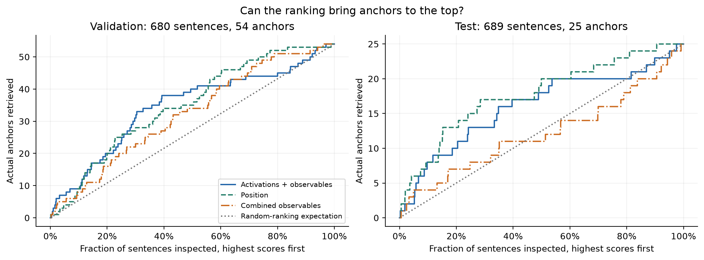
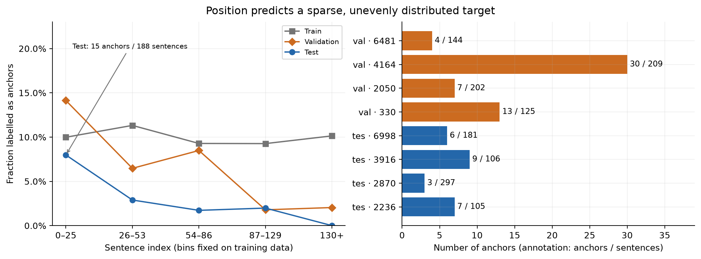
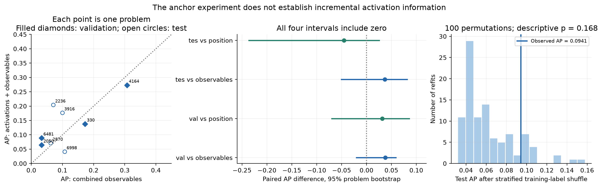
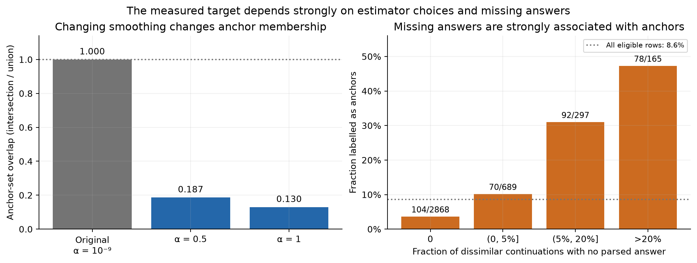
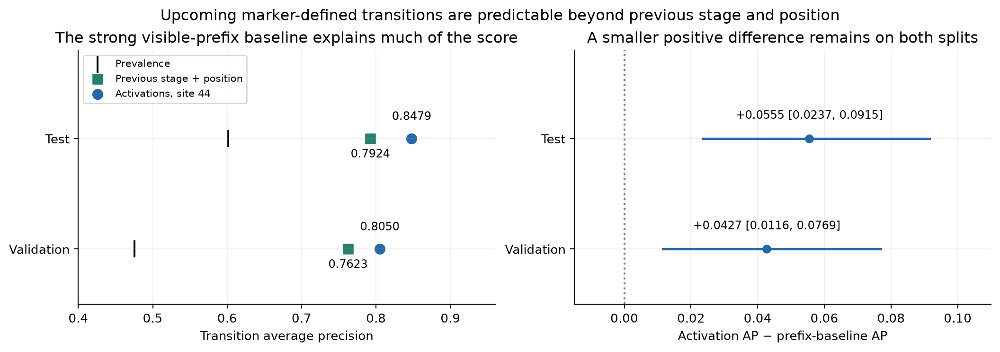
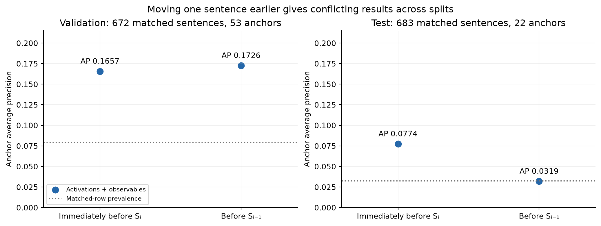
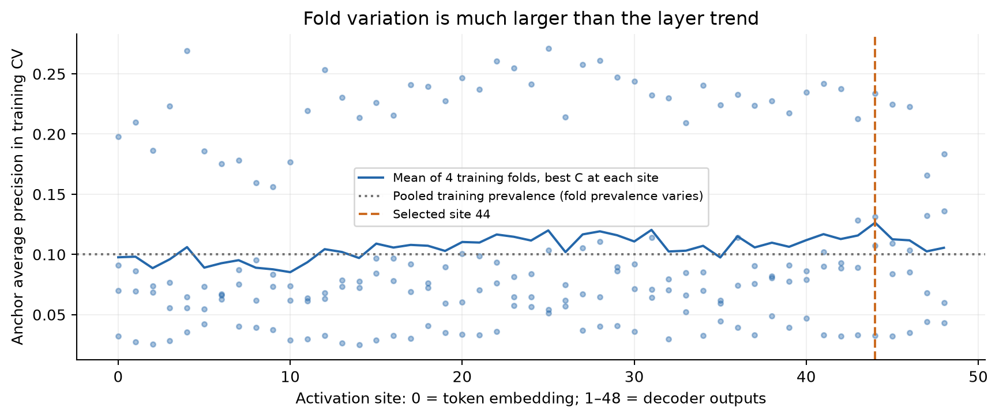

# Can we predict an important reasoning step before it happens?

*An experiment in forecasting thought anchors—and what a weak result taught me about the target.*

Before a reasoning model generates an important step, can we predict that step's importance using information already available? If we can, what signals make the prediction possible, and how far ahead do they appear?

I wanted to make these two questions concrete. My first experiment used **thought anchors**: reasoning sentences whose replacement, through model resampling, substantially changes the distribution of final answers. I tried to predict these sentences from the model's internal state immediately before their first token.

The answer was weaker than I hoped. An activation probe ranked anchors above the prevalence reference, but simple position information was highly competitive. On the four test problems, position had the higher point estimate. Neither the paired uncertainty estimates nor the permutation control established incremental anchor-prediction value from activations. Investigating this result exposed substantial sensitivity in the importance target itself.

The same boundary states did predict something else: whether the next sentence would change its **marker-defined reasoning stage**. That result survives a stronger baseline using the previous sentence's stage and position, although the gain becomes much smaller. It may reflect preparation for upcoming words rather than an abstract reasoning phase. Useful forecasting farther ahead remains unresolved.

This is a small investigation: one model, twenty public mathematics problems, and only twenty-five test anchors. Its contribution is to narrow a forecasting question and identify the experiments that would make the next answer more informative.

## Turning a broad safety question into an experiment

I keep encountering arguments that make technical progress on alignment sound close to hopeless. I deliberately try not to let that become an excuse to stop troubleshooting concrete problems. One way I do that is to turn broad questions into small empirical experiments.

Much safety work begins after a capability, propensity, or failure becomes externally visible. Behavioural evaluations tell us that something happens; we then investigate why and what to do about it. I am interested in whether model states, together with information available during reasoning, can sometimes provide earlier predictive signals.

That question was too large to reason about productively in the abstract. Reading model-forensics work and research on counterfactual resampling suggested a narrower starting point: forecast an event inside an observable reasoning trace. [Thought Anchors](https://arxiv.org/html/2506.19143v4) supplies a way to ask which steps matter by comparing resampled continuations. [Thought Branches](https://arxiv.org/abs/2510.27484) develops the broader argument for studying distributions of reasoning paths, including the possibility that removed content reappears later.

My question changes the timing: **can an event's subsequently measured importance be anticipated before the event is generated?** Thought anchors are a first operational target for that question. Predicting them would still be a long way from forecasting emerging capabilities or misalignment.

## What counts as an important step?

Imagine a model halfway through solving a mathematics problem. It is about to write a sentence choosing a strategy. To estimate how much that sentence matters, I compare two experiments:

1. Keep the original sentence and sample many continuations from immediately after it.
2. Restart immediately before it, let the same model generate alternative continuations, and retain those whose first replacement sentence differs sufficiently from the original.

If these experiments produce very different final-answer distributions, the original sentence receives high counterfactual importance. A sentence can be influential even if it steers the model toward a wrong answer. Importance here is about changing the distribution of answers, not improving accuracy, sounding insightful, or directly measuring divergence between entire reasoning trajectories.

The replacement is sampled from the model. It is not a deletion, a blank, or a paraphrase written by another model. Replacements count as dissimilar when their MiniLM sentence-embedding cosine similarity to the original is below 0.8. The “with” distribution uses all continuations from the next fork; it does not pool in similar replacements from the earlier fork.

Formally, let \(n^-_a\) and \(n^+_a\) count normalised answer category \(a\) among dissimilar replacements and sentence-preserving continuations. With sample totals \(N^-\) and \(N^+\), and \(K\) categories in their combined support, the implemented score is

\[
p^-_\alpha(a)=\frac{n^-_a+\alpha}{N^-+\alpha K},\qquad
p^+_\alpha(a)=\frac{n^+_a+\alpha}{N^++\alpha K},
\]

\[
I(S_i)=D_{\mathrm{KL}}(p^-_\alpha\Vert p^+_\alpha)
=\sum_a p^-_\alpha(a)\log\frac{p^-_\alpha(a)}{p^+_\alpha(a)}.
\]

KL divergence measures how different the two answer distributions are, in the specified direction. The logarithm is natural. The primary smoothing parameter is \(\alpha=10^{-9}\). Smoothing assigns a small probability to categories absent from one finite sample, avoiding division by zero. This apparently technical choice turns out to matter enormously.

The category set always includes `<NO_ANSWER>`, which collects missing or empty normalised answers. This retains failures to obtain an answer as outcomes, but does not distinguish truncation, parsing failure, and genuine non-answering.

For the primary prediction task, I convert importance into a binary label:

\[
\operatorname{anchor}(S_i)=\mathbf{1}[I(S_i)\geq 1.3549810893].
\]

That threshold is the 90th percentile of **eligible training sentences**. The same numerical threshold is applied to validation and test. Anchors are therefore defined by high measured importance; they are not an independently annotated category that merely correlates with it. Nor is each split forced to contain 10% anchors. A secondary regression predicts \(\log(1+I)\), retaining the continuous target.

The experiment reuses the released Thought Anchors traces and counterfactual samples. It does not simply trust the released importance field. A specified audit on Problem 4682 found a released-versus-canonical rank correlation of 0.858, below the required 0.95. The pipeline therefore recomputed the canonical score from released resamples for all forty trajectories. That disagreement compares implementations; it is **not** an estimate of repeated-sampling label reliability.

## Predicting before the sentence exists

The model is DeepSeek-R1-Distill-Qwen-14B. The dataset contains one released correct trajectory and one released incorrect trajectory for each of twenty MATH problems. Importing the released chunks gives 6,474 sentence units; 4,019 enter the primary anchor experiment.

Eligibility requires an aligned sentence and an unambiguous token boundary, adjacent resampling forks, at least one dissimilar replacement, and finite importance. Final-answer emission and later material are excluded, as are sentences at or after the pipeline's convergence cutoff. That cutoff starts at five consecutive forks whose answer accuracy is consistently at most 1% or at least 99%. This is an accuracy proxy, not direct agreement on an answer—a distinction I return to below.

The prediction point is:

```text
… previous reasoning … [BOUNDARY STATE] → first token of Sᵢ → rest of Sᵢ
                          predictor stops here
```

The exact stored trace is tokenised once. The boundary is the token immediately before the first token overlapping the target sentence. If a token spans the whitespace before the sentence and its opening word, that entire token belongs to the target and is excluded from the prefix.

I replay each trace causally through the pinned model and save only boundary states: the embedding output, called site 0, and the outputs of all 48 decoder blocks before the final normalisation. Each state has 5,120 dimensions. The predictor never receives the target sentence's text, its first-token probability, future activations, final trace length, or eventual correctness.

What should those states be compared against? At the same boundary, several much simpler quantities are available:

| Baseline | Information available before the sentence |
|---|---|
| Position | Sentence index, generated tokens so far, prefix tokens divided by the fixed context-window capacity |
| Context | Prefix token count, its logarithm, previous sentence's token length |
| Uncertainty | Previous emitted token's log-probability; next-token entropy, maximum probability, top-two probability margin, and top-five/top-ten probability mass |
| Combined observables | All twelve features above in one fitted predictor |

These are numerical features, not hand-assigned “early/middle/late” labels. The context-window fraction uses the fixed capacity of 32,768 tokens, not the unknown completed trace length. The uncertainty baseline uses the model's output probabilities; it is not purely a text-only baseline. Crucially, its scalar summaries discard **which tokens** are likely.

All binary predictors are regularised logistic regressions. Activation-only probes receive one boundary state; activation-plus-observables probes receive that state concatenated with the twelve features. The combined baseline learns its feature weights from training examples. Giving it more features does not guarantee better generalisation.

The split keeps whole problems together, including both trajectories:

| Split | Problems | Eligible sentences | Anchors |
|---|---:|---:|---:|
| Training | 12 | 2,650 | 265 |
| Validation | 4 | 680 | 54 |
| Test | 4 | 689 | 25 |

Layer and regularisation selection use four-fold grouped cross-validation on the twelve training problems. Scaling and residualisation are fitted inside training folds. The primary selection was site 44 with \(C=0.1\). Validation scores fit a probability calibrator; the selection was then frozen before the single locked test evaluation. The ranking results below use raw decision scores.

The boundary checks support the intended timing, with a numerical qualification. Replacing future tokens while preserving sequence shape left checked boundary states unchanged. Truncated-prefix replay did not always numerically match full-trace replay at short prefixes; the documented amendment treats that comparison as a diagnostic because of shape-dependent BF16 rounding. I do not claim that both tests passed unchanged.

These safeguards protect the comparison, but do not make the test pristine. The problems were already public and analysed in the source research. This is an **exploratory held-out engineering test**, with four independent test problems—not 689 independent replications.

## Can the probe bring anchors to the top?

The first question is straightforward: if I rank sentences by predicted anchor likelihood, do actual anchors appear near the top?

I measure this using **average precision**, or AP: a summary of precision as the ranking retrieves more positives. Higher is better. A constant-score predictor has AP equal to the evaluated split's prevalence, which provides the no-discrimination reference. Here that reference is 0.0794 on validation and 0.0363 on test. AP is not classification accuracy or the probability that a particular warning is correct.

The selected activation-plus-observables probe achieves **0.1645 on validation and 0.0941 on test**. The activation-only probe is similar: 0.1711 and 0.0925. These are above-prevalence point estimates. Looking at the highest-ranked 10% of test sentences makes the result tangible: the primary probe retrieves eight of the twenty-five anchors among sixty-nine inspected sentences.

But position alone also retrieves eight. Across the full test ranking its AP is **0.1394**, higher than the activation probe's point estimate. On validation, position reaches 0.1330, below the primary probe. The curves show both the predictive association and the immediate challenge to an internal-signal interpretation.



*Figure 1. Can the ranking bring anchors to the top? Each step counts a retrieved anchor as progressively more sentences are inspected. The dotted diagonal is the expected cumulative count under random ranking. Validation has 54 anchors; test has 25, so the discrete steps matter. Activations improve on the prevalence reference, but position is competitive and has higher test AP. This figure shows retrieval on these splits, not established incremental information or a calibrated warning system.*

## The obvious alternative: perhaps importance depends on where we are

Position is a serious scientific baseline. Earlier decisions can affect more of the subsequent computation. Alternatively, counterfactual answer distributions may have more opportunity to diverge when the intervention leaves a longer continuation. These explanations can coexist, and the current experiment does not distinguish them.

The test labels have a clear positional pattern. At sentence indices 0–25, fifteen of 188 eligible sentences are anchors: 8.0%. At later indices, ten of 501 are anchors: 2.0%. Those first twenty-six sentence positions contain 60% of test anchors.

The definition of “early” matters. Indices 0–25 form the lowest position bin under cuts estimated from the training data. They are **not** the first fifth of every trajectory. Using within-trajectory eligible-sentence rank instead puts only seven test anchors in the first fifth. Different position measures answer different questions.



*Figure 2. Position and problem composition both matter. Left: anchor prevalence in sentence-index bins with boundaries fixed from eligible training rows. The training profile is approximately flat in these absolute-position bins; the held-out profiles are different. Lines connect bin summaries, not a fitted continuous trend. Right: anchor counts for every held-out problem, annotated with the sentence denominator. Position is predictive on test, but neither a universal monotone positional law nor its causal explanation follows from these data.*

The sample is also uneven. Problem 2870 contributes 297 of the 689 test sentences but only three anchors. Problem 3916 contributes nine anchors among 106 sentences. On validation, thirty of fifty-four anchors come from Problem 4164, including twenty-three from its incorrect trajectory.

A sentence-pooled score can therefore change substantially with the mixture of problems. That is why the next comparison needs uncertainty at the problem level.

## Do activations add anything beyond the simpler predictors?

The central comparison is

\[
\Delta\mathrm{AP}=\mathrm{AP}(\text{activations + observables})
-\mathrm{AP}(\text{observables}).
\]

The combined-observables baseline reaches test AP 0.0573. The primary probe's improvement is **+0.0368**, with a paired 95% problem-bootstrap interval of **[−0.0505, +0.0814]**. On validation, the improvement is +0.0379, with interval [−0.0203, +0.0590]. Both include zero.

Against the stronger test position baseline, the primary probe's difference is **−0.0452**, with interval **[−0.2364, +0.0255]**. Validation points the other way: +0.0315, with interval [−0.0699, +0.0857]. These intervals establish neither activation superiority nor position superiority across a broader population.

The bootstrap resamples problems, bringing along both trajectories and every sentence whenever a problem is selected. The competing predictors are evaluated on the same resampled problems. Resampling sentences independently would treat strongly related observations as independent evidence. Even the correctly clustered intervals remain descriptive with only four problems per held-out split; they also condition on the already fitted predictors.



*Figure 3. The incremental anchor result remains unresolved. Left: each point compares AP for the primary probe and combined observables on one problem; the diagonal marks equal performance. Middle: pooled paired differences against combined observables and position, with 2,000-replicate problem-bootstrap intervals and a zero reference. Right: test AP from 100 refits after shuffling training labels within problem, trajectory kind, and training-defined position bins. The observed score lies within that structured null distribution. These controls do not establish an incremental activation advantage; they also cannot exclude a smaller effect.*

The permutation control asks whether the observed result is unusual after breaking sentence-specific training associations while retaining substantial problem, trajectory, and coarse position structure. With the selected layer and regularisation held fixed, its descriptive plus-one tail probability is **0.168 on test** and **0.099 on validation**. It does not rerun layer selection and is not a direct test of conditional independence between activations and labels. Nevertheless, it gives no strong reason to regard this score as an importance-specific discovery.

A residualised control removes the component of activations linearly predictable from the twelve observables before fitting the probe. Its test AP is 0.1267, still below position's point estimate. Removing a fitted linear projection does not remove every nonlinear or lexical correlate of position and context, so that score cannot settle the interpretation either.

Other checks do not turn this into a stable positive result. The stricter training-95th-percentile target leaves ten test positives; refitting at the frozen hyperparameters gives AP 0.0398 for activations plus observables versus 0.0508 for combined observables. Four-fork convergence and minimum replacement-support controls preserve some above-reference point estimates, but do not resolve the main uncertainty. Subgroups differ sharply: the frozen primary probe has AP 0.2868 on correct test trajectories and 0.0355 on incorrect ones, with only thirteen and twelve anchors respectively.

My answer at this point is: **there is weak measured predictability, but I could not establish incremental thought-anchor information in activations beyond strong observable comparisons.** That is not evidence that no internal signal exists.

## A more basic problem: the target changes under reasonable estimator choices

A weak predictor raises two questions. Perhaps the state does not contain much information about the target. Or perhaps the target is an unstable measurement of the property I intended to forecast.

The saved label sensitivities make the second concern concrete.

**Changing smoothing changes which sentences count as anchors.** Across all 4,019 eligible sentences, importance ranks under \(\alpha=10^{-9}\) correlate with those under \(\alpha=0.5\) at Spearman 0.705, and under \(\alpha=1\) at 0.598. Recomputing the training-only 90th-percentile cutoff for each alternative gives anchor-set Jaccard overlaps of **0.187 and 0.130** with the primary labels. Jaccard overlap is the intersection divided by the union; identical sets would score 1.

Only 117 of the original 344 anchors remain anchors under \(\alpha=0.5\), and 86 under \(\alpha=1\). This is substantial membership churn, even though the original traces and resamples have not changed.

Why? With extremely small smoothing, an answer observed among replacements but absent from the sentence-preserving sample receives a very large likelihood ratio. An unobserved answer in a sample of roughly one hundred continuations need not have truly negligible probability. The score can therefore be highly sensitive to finite-sample support differences. Larger smoothing changes the emphasis. These checks do not tell us which estimator is best; they show that the chosen target is not insensitive to that choice.

**Missing answers are strongly associated with importance.** Among sentences with no `<NO_ANSWER>` outcomes in their retained dissimilar continuations, the anchor rate is 3.6%. It rises to 10.2%, 31.0%, and 47.3% as that missing-answer fraction moves through (0, 5%], (5%, 20%], and above 20%. Its rank correlation with importance is 0.452.



*Figure 4. Two empirical concerns about the measurement target. Left: overlap with the primary anchor set after changing smoothing and independently recomputing each training-only threshold, evaluated on the same 4,019 eligible rows. Right: anchor rates grouped by the fraction of dissimilar continuations with no parsed answer; annotations show anchors/rows, and the dotted line is pooled prevalence. The left panel demonstrates estimator sensitivity. The right demonstrates association, not how much KL is caused by the missing-answer category or why answers are missing.*

This changed how I interpret the weak probe result. A predictor could learn something about the likelihood of unsuccessful answer extraction, remaining continuation horizon, or the support of the answer estimator and still predict “anchors.” Conversely, instability in measured importance could obscure a real precursor of consequential reasoning.

I do not yet know how much of either explanation is true. The stored counts do not by themselves decompose KL into missing-answer and substantive-answer contributions. The experiment also lacks a systematic estimate of per-sentence reliability under repeated counterfactual sampling. Smoothing sensitivity is evidence of estimator sensitivity, not a direct measurement of sampling noise or a bound on achievable prediction.

Eligibility creates another measurement issue. Consistently near-zero accuracy does not imply convergence to one answer: all samples might be wrong in different ways. The four-versus-five-fork check changes the cutoff's persistence requirement without fixing that conceptual problem. And 608 sentence rows are excluded for having no dissimilar replacements under the implemented support rule. The evaluated population is a selected subset of reasoning, determined partly by retrospective information.

Finally, each boundary is paired with the importance of the **one sentence that actually appeared**. A stochastic model could produce several possible next sentences from the same prefix, with different downstream importance. Forecasting that distribution is different from forecasting one realised member of it. The present dataset does not measure how large this within-prefix variation is.

## A positive control: what does the state predict?

The anchor result could still reflect a more general failure of the probing approach. To investigate that possibility, the exploratory follow-up changes the target: predict the form of the upcoming reasoning step.

It assigns seven stages using deterministic, ordered rules over sentence text: **orient, plan, compute, verify, backtrack, conclude, and other**. For example, planning language includes “Let me try”; verification includes checking language; backtracking includes “Wait” and error markers. “Compute” is a broad fallback for mathematical content. The rules resolve overlaps by priority, so “Wait, let me check” can be labelled verification.

These are reproducible surface labels, not independently validated annotations of cognitive function. The task is also larger and less imbalanced than anchor prediction: stage classification uses all 6,474 sentence units, and a transition means simply

\[
\operatorname{stage}(S_i)\ne\operatorname{stage}(S_{i-1}).
\]

The transition experiment excludes the first sentence of each trajectory. Validation contains 644 transitions among 1,355 sentences; test contains 645 among 1,073. Transition prevalence is therefore 47.5% and 60.1%, very different from anchor prevalence. An AP of 0.8 cannot be interpreted by comparing it directly with anchor AP near 0.1.

At the immediate boundary, the site-44 activation probe achieves transition AP **0.8050 on validation and 0.8479 on test**. Comparing only with position—0.4054 and 0.6261—makes this look like a very large internal-state advantage.

The obvious problem is that we have already seen the previous sentence. Its stage can be computed from the visible prefix using exactly the same rules that define the target. Knowing that stage helps predict whether a change is likely next.

That stronger **previous-stage-plus-position baseline** reaches **0.7623 on validation and 0.7924 on test**. Against it, the activation-only advantage falls to:

- **Validation:** +0.0427 AP; paired problem-bootstrap interval **[+0.0116, +0.0769]**.
- **Test:** +0.0555 AP; interval **[+0.0237, +0.0915]**.



*Figure 5. A smaller transition advantage survives the strongest established visible-prefix baseline. Left: AP for the activation-only probe and previous-stage-plus-position baseline, with each split's own prevalence tick. The AP axis is restricted to 0.4–0.96 to show the comparison. Right: their paired differences with 2,000-replicate problem-bootstrap intervals. The existing models were reproduced at their saved training-selected regularisation values. Both intervals are positive, but each split contains four problems, the comparison is exploratory, and richer lexical or next-token baselines remain untested.*

This is a useful positive control. The extraction and linear readout can recover out-of-problem information about an upcoming event, and the advantage over this stronger baseline has the same direction on both held-out partitions. It weakens the explanation that the pipeline simply cannot decode anything useful.

It does **not** show that the anchor experiment was adequately powered. The targets, class balance, eligible population, and likely effect sizes differ. Nor does success here rescue the original importance hypothesis.

The stage labels provide little support for the idea that anchors are just reasoning-mode changes. On eligible training-plus-validation rows, the anchor rate is 9.69% at transitions versus 9.33% at same-stage continuations; the problem-bootstrap interval for the difference is [−0.0230, +0.0282]. A diagnostic using the target sentence's own stage predicts test anchors at AP 0.0351, approximately their prevalence. That diagnostic deliberately uses future information and is not a deployable pre-emission predictor. These results weaken this particular stage-based explanation; they are not a causal mediation analysis.

## Is this reasoning preparation—or preparation to say “Wait”?

The positive control has its own obvious alternative explanation.

Of 830 sentences labelled backtracking, **770—92.8%—open with a “Wait”, “Hmm”, “Hold on”, or related marker from the rule set**. Across the dataset, 733 sentences literally begin with “Wait.” Other labels also depend on lexical patterns, mathematical symbols, and answer-formatting cues.

A language model's boundary state is used to predict its next token. Recovering information about upcoming marker-defined stages may therefore be recovering preparation for those next words. The twelve original observables cannot test that explanation: entropy and top-token probability mass describe how concentrated a distribution is, while discarding token identity.

The distinction matters. **Predictability** means a feature forecasts a label. **Incremental prediction** means it improves on a specified comparison. Decoding can reveal information present in a representation, but does not establish an abstract reasoning-phase variable, show that the model causally uses such a variable, or identify the mechanism controlling a transition.

The layer evidence does not close this gap. Stage identity decoding at site 44 gives macro-F1 0.4571 on validation and 0.3845 on test, compared with 0.1382 and 0.1060 at the embedding output. Macro-F1 gives each stage equal weight when averaging class-level precision/recall performance. Only sites **0 and 44** were tested for this task. They support a difference between those sites, not a full layer-wise emergence story.

The anchor sweep covers all 49 sites, but its fold variation is much larger than its layer trend. The selected configuration's fold APs are approximately 0.033, 0.131, 0.107, and 0.234. Site 44 is the training-CV maximum, not evidence of a privileged anchor mechanism. Site-0 performance also motivates a missing control: the identity of the token immediately preceding the sentence, whose embedding is exactly what site 0 contains. The full fold-aware plot is in the appendix.

I do not think the current experiment distinguishes high-level preparation for a reasoning transition from short-range lexical preparation.

## How far ahead does the information exist?

This brings me back to the second research question. Only **two sentence-level distances** were evaluated: immediately before \(S_i\), called lead zero, and immediately before \(S_{i-1}\), called lead one. There is no measured lead-two-or-longer curve.

For anchors, moving earlier produces inconsistent results across the held-out splits. Comparing exactly the same target rows at both distances:

- **Validation:** AP changes from **0.1657 to 0.1726**, on 672 sentences containing 53 anchors; prevalence is 0.0789.
- **Test:** AP changes from **0.0774 to 0.0319**, on 683 sentences containing 22 anchors; prevalence is 0.0322.



*Figure 6. Anchor lead-time evidence disagrees across splits. Each panel evaluates the same sentences at both boundaries, excluding targets without a predecessor. Lead zero uses the frozen primary predictor; lead one is refitted on earlier-boundary training features at the frozen layer and regularisation. Dotted lines mark matched-row prevalence. Test falls to approximately prevalence; validation does not fall. Only these two distances were measured, so the plot does not establish a decay curve or a universal disappearance of signal.*

The transition activation-only probe remains more predictive at lead one: AP 0.7653 on validation and 0.8220 on test. But the stage-sequence explanation becomes particularly relevant here. Before \(S_{i-1}\), the state may anticipate that sentence's stage; that stage in turn predicts whether \(S_i\) will differ from it.

An exploratory oracle supplies the actual intervening stage. It is unavailable at lead one, although it is the legitimate visible-prefix baseline at lead zero. The saved oracle-plus-position model reaches AP 0.7623 and 0.7924. Adding lead-one activations to that oracle gives a small gain whose interval crosses zero on validation: +0.0108 [−0.0149, +0.0316]. The test gain is +0.0343 [+0.0011, +0.0807].

There is an additional timing limitation in these exploratory comparisons: their position-augmented lead-one arms use target-boundary position fields, including token counts accumulated during the intervening sentence. Those are not all available at the earlier boundary. I therefore treat these as diagnostic comparisons, not clean longer-horizon forecasts. The activation-only lead-one results avoid that issue, as does the primary anchor lead-one implementation, which shifts both activations and observables.

There is no consistent evidence here for forecasting anchor importance a whole sentence earlier, and no clean demonstration that transition forecasting extends beyond anticipation of the intervening sentence's form. Question 2 remains mostly open.

## What I think this experiment established

I wanted to know whether important reasoning events can be forecast before they happen. The narrow answer is that the implemented thought-anchor label has some above-prevalence predictability on these held-out problems, but **this experiment does not establish added predictive value from activations beyond strong observable baselines**.

The measurement investigation is part of that answer. Anchor membership changes substantially with smoothing, missing-answer frequency is strongly associated with importance, and eligibility relies on a questionable convergence proxy. These are reasons to improve and validate the target, rather than interpret a weak probe as a clean statement about the model's ability to anticipate consequential reasoning.

The more positive result concerns immediate reasoning form. Pre-emission states predict marker-defined transitions better than the tested previous-stage-plus-position baseline on both held-out partitions. That is evidence of useful short-horizon decodability within this experiment. It is not yet evidence of abstract reasoning-state representation, causal use, or a discovered mechanism.

The scope remains small: one model, one dataset, selected correct/incorrect traces, twelve training problems, and four problems in each held-out split. The follow-ups reused public problems after the original test results were known. They are exploratory construct validation, not independent confirmation and not a deployable safety monitor. The probe remained a passive offline observer; it never supplied a training or reward signal.

## What I would test next

**1. Give the transition result a serious lexical competitor.** Start with the preceding token and preceding several tokens, previous-sentence stage, and flexible position features. Then compare against richer prefix-text predictors and the full next-token distribution, including probability assigned to stage-opening markers. If the activation advantage disappears, the short-range wording explanation gains support. If it remains, use independently audited functional stage labels and boundaries several tokens before the sentence opening to test whether the result extends beyond marker anticipation.

**2. Measure the reliability and meaning of importance before scaling the probe.** Bootstrap or split the existing counterfactual samples where raw rollouts are available, then repeat resampling on a small, prospectively chosen set of boundaries. Decompose the missing-answer contribution, separate truncation from parsing failure where possible, and compare explicitly defined targets that include, exclude, or separately model missing answers. Evaluate smoothing alternatives as estimator choices under a new protocol. A continuous target avoids a hard threshold, but cannot by itself repair an unstable importance estimate.

**3. Disentangle leverage from continuation opportunity.** Replace the accuracy proxy with actual answer-distribution concentration, and compare events matched on information available at the boundary using stronger position controls. Use remaining-horizon measures only as retrospective diagnostics; do not quietly turn completed trace length into a forecasting feature. An intervention that holds continuation opportunity comparable would help distinguish early causal leverage from properties of the measurement procedure.

**4. Test earlier prediction on genuinely new problems.** Once the target and strongest baselines are fixed, collect fresh held-out problems and evaluate token offsets, lead one, and lead two or more on matched target sets. All predictor inputs must be shifted to the actual forecast boundary. Multiple possible next sentences from the same prefix would reveal whether the forecastable object is the importance of a realised step or a distribution over possible consequential steps. A full stage-decoding layer sweep would then be useful, but is less decisive than fixing the target and lexical controls first.

The useful thing I learned is that forecasting an important step requires two separate achievements: predicting something before it appears, and showing that the predicted quantity captures the importance we care about. This experiment makes the first plausible for immediate reasoning form. It leaves the second, and meaningful earlier warning, unresolved.

## Technical appendix

**Model and data.** Model/tokenizer revision: `deepseek-ai/DeepSeek-R1-Distill-Qwen-14B@1df8507178afcc1bef68cd8c393f61a886323761`; dataset: `uzaymacar/math-rollouts@a3a2fe1eb6d52e6ef81860baff018a8df2eb8ae2`. Extraction uses BF16, SDPA, no quantisation, the exact stored prompt/trace without a new chat template, and boundary-selective hooks. Stored states are FP16; probability summaries are calculated in float32 from the final stored state, final normalisation, and output head.

Training problems are 2238, 1591, 4682, 6596, 3448, 2189, 3550, 4605, 2137, 4019, 3360, and 3935. Validation uses 330, 4164, 2050, and 6481; test uses 6998, 2236, 2870, and 3916. Both released trajectories always stay together. These curated correct/incorrect pairs are not representative samples from ordinary deployment.

**Estimation and selection.** Binary probes use training-fitted standardisation, balanced class weights, L2 logistic regression, and \(C\in\{10^{-4},10^{-3},10^{-2},10^{-1},1,10,100\}\). Each activation family is swept over all 49 sites; baselines receive the same regularisation grid and grouped folds, but naturally have no layer-selection dimension. The global training-only anchor cutoff is fixed before probe CV; it is not recalculated independently inside each fold. Thus held-out CV-fold importance values contribute to the definition of that fixed target, although validation/test labels do not determine it. Feature scaling, residualisation, and predictor fitting remain fold-local.

The primary continuous activation-plus-observables model uses Ridge regression on \(\log(1+I)\), selected by training-CV Spearman correlation with RMSE as tie-breaker. Its selected site is 28 and regularisation is \(10^4\); held-out Spearman correlations are 0.2173 on validation and 0.2370 on test. This is a secondary association, not a demonstrated gain beyond strong continuous baselines. Multiclass stage probes use fixed \(C=0.1\); binary transition probes use grouped training-CV selection. The reproduced transition comparison uses \(C=10^{-4}\) for activations and \(10^{-3}\) for previous stage plus position.

**Label provenance and pilot.** Released raw forks typically contain 100 continuations before similarity filtering; retained dissimilar counts vary. A separate fresh pilot generated 32 continuations at each of eight unique forks for five targets on Problem 4682, using temperature 0.6, top-p 0.95, maximum 16,384 generated tokens, and recorded sample seeds. Its five dissimilar-support counts were 32, 29, 20, 32, and 10. It checks generation and label-construction mechanics; it is not a systematic reliability study and does not supply the main replay labels. Early defective label artifacts were superseded; this post uses the corrected canonical table with 4,019 eligible rows and threshold 1.3549810893. Most released raw resample files were not present in the local material available for this writing audit: I checked the construction code and saved corrected labels and sensitivity columns, rather than independently rebuilding every KL score from raw continuations.

**Timing qualifications.** For 1,930 eligible rows, a token overlaps the target's character start. The activation boundary excludes it, as required. The audit also records that character-truncated generation prefixes can contain an additional trailing whitespace token relative to the full-trace activation prefix. This conditioning mismatch deserves an explicit stratified or harmonised-boundary follow-up. Offline eligibility and sentence boundaries are supplied by the completed traces; the study does not implement an online event-boundary detector. Same-shape mutation checks support causal extraction, while short-prefix numerical discrepancies remain recorded under the approved invariance-test amendment.

**Uncertainty and status.** The primary comparison and listed MVP controls were specified and frozen in the pipeline; saved files mark preregistration status, but this should not be read as an independent external preregistration. Public-data reuse makes the overall evaluation exploratory. Stage prediction, stronger transition-baseline interpretation, and target audits are post-hoc. All quoted bootstrap intervals resample problems, retain both trajectories, and condition on fitted models. They do not include uncertainty from redoing model selection or counterfactual label estimation. The transition intervals in Figure 5 are independently recomputed using recorded seeds, rather than copied from the earlier prose audit.



*Supplementary Figure S1. The anchor layer sweep with fold variation retained. Dots show all four training-fold APs at each site's best regularisation; the line is their mean for activations plus observables. The dotted reference is pooled training prevalence—individual folds have different prevalences. Site 44 is the selected maximum. This is training-CV evidence, not a held-out layer sweep or evidence that site 44 has a distinctive causal role.*

**Artifacts and reproduction.** The accompanying [evidence record](evidence.json) contains exact values and input SHA-256 hashes; [transition predictions](transition_predictions.parquet), [bootstrap draws](bootstrap_draws.parquet), and [target-audit rows](target_audit.parquet) support the updated figures. The verification and plotting code is [blog_evidence.py](../../src/preanchor/report/blog_evidence.py). It reads the corrected Stage 4 labels and Stage 7 features under `~/preanchor-root`, Stage 8 run `20260915T193326Z-57bcb41c84-7ebd0db6`, frozen Stage 9 run `20260915T201107Z-484989d2fe-19f1ab0d`, Stage 10 run `20260915T211903Z-b230473011-815ca2b7`, and the [reasoning-stage artifacts](../reasoning_stage/outputs/analysis_results.json). The frozen-selection SHA-256 is `e68f1d829145431481d81d25c1546773d81e66c3cd3a39a1fdd98f298113e0bf`. Numerical verification here uses saved artifacts and CPU refits, not a new GPU replay or a rerun of the locked test command.
