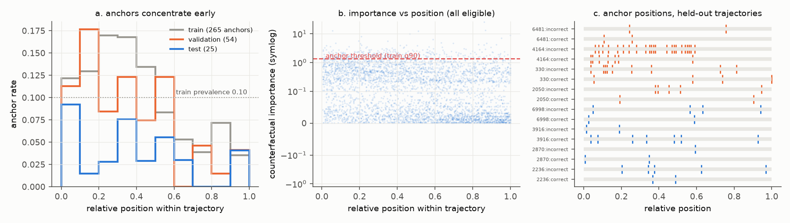
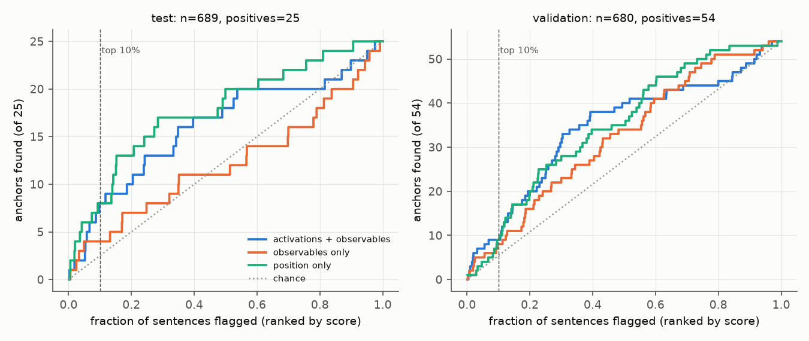
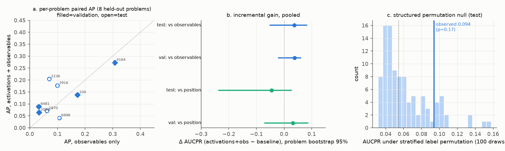
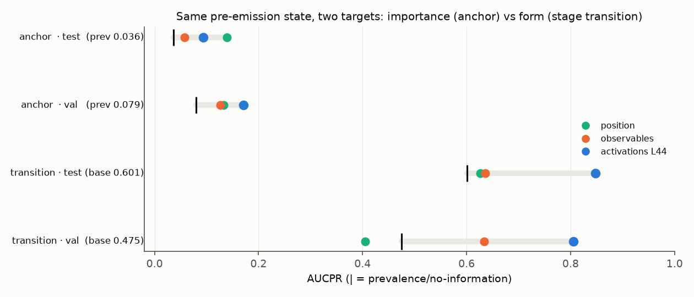
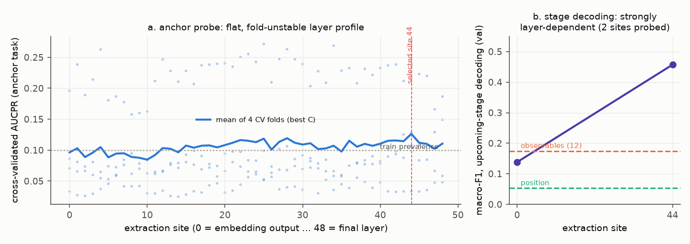
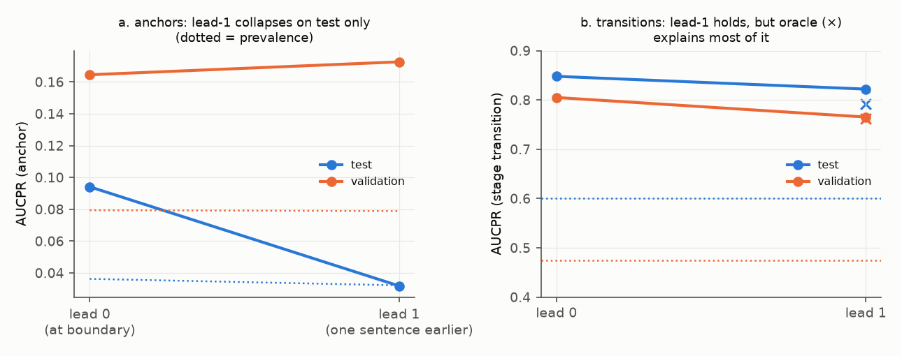

# Evidence-driven figure plan for the write-up

2026-09-18. Built by inspecting the saved artifacts directly (sentence tables, per-sentence
predictions from every arm, CV folds, permutation draws, lead-time predictions, stage labels),
not from the existing result summaries. Preliminary validation plots are in `prelim/` and were
generated by `make_prelim_plots.py`; they confirm each proposed encoding is supported by the
actual data before any polishing effort is spent.

**The visual argument in one paragraph.** Figure 1 shows what the target is and where it
lives: a heavy-tailed counterfactual-importance score, sparse binary anchors that concentrate
early in trajectories, a test split whose importance distribution is shifted down, and
held-out evidence that is discrete and unevenly spread over 8 problems. Figure 2 shows the
central result as retrieval: ranking held-out sentences by the activation probe finds anchors
well above chance — and ranking by position alone does about as well on test. Figure 3 shows
the key inferential null: the paired, problem-resampled gain of activations over the
registered observables is compatible with zero, and the observed score sits inside its
permutation null. Figure 4 shows the discriminating positive control: the same boundary state
that barely predicts *importance* strongly predicts the *form* of the upcoming step (reasoning
stage / stage transition), far beyond position and observables and robustly across both
held-out splits — so the pipeline can detect real pre-emission signal when it exists, and the
anchor null is not a power artifact of the method. Figure 5 shows why no mechanistic reading
is licensed: the anchor probe's layer profile is flat and fold-unstable from the embedding
output onward, while stage decoding is strongly layer-dependent.

---

## 1. Data inventory (Step 1)

All paths relative to `~/preanchor-root` (restored Stage 10 bundle) unless prefixed `repo:`.
"Unit" = unit of observation. Model: DeepSeek-R1-Distill-Qwen-14B, activation site
`block_post_pre_final_norm`, 49 extraction sites × d=5120, fp16.

| Dataset | File | Unit | n | Key contents | Split | Kind |
|---|---|---|---|---|---|---|
| Sentences | `data/processed/stage3/sentences.parquet` | sentence | 6,474 | text, `sentence_idx`, trajectory/problem ids, char spans | all | raw |
| Trajectories | `data/processed/stage3/trajectories.parquet` | trajectory | 40 (20 problems × correct/incorrect) | full CoT, correctness, ground truth | all | raw |
| Labels | `data/processed/stage4/labels.parquet` | sentence | 6,474 (4,019 eligible) | `importance_canonical/primary` (+α=0.5, 1.0 variants), `anchor` (train-q90 threshold 1.35498), eligibility + exclusion reasons, `convergence_idx`, `final_answer_idx`, fork counts | all | derived label |
| Observable features | `data/processed/stage7/features.parquet` | sentence | 6,474 | 12 registered observables: position block (`sentence_idx`, `generated_token_count`, `prefix_context_fraction`), context block (prefix tokens, prev-sentence tokens, prev-token logprob), uncertainty block (next-token entropy, max-prob, margin, top-5/10 mass), split assignment | train/val/test | raw features |
| Activation store | `artifacts/runs/…182306Z…/activations/` (`index.parquet` + 40 safetensors) | sentence-boundary | 6,474 × 49 sites × 5120 | pre-emission residual state at every site; `final_prev_position` (boundary −1 token) diagnostic | all | raw |
| Stage-8 CV metrics | `…193326Z…/probe_models/cv_results.parquet` | probe × layer × C × fold | 6,596 rows | 4-fold grouped-CV AP/AUROC for 8 probe families × 49 sites × C grid | train (CV) | derived |
| Stage-8 OOF predictions | `…193326Z…/probe_models/fold_predictions.parquet` | sentence × config | 4.37 M | out-of-fold `score_raw`/`probability` for every CV config incl. q80/q90/q95 and lead variants | train (OOF) | prediction |
| Stage-9 frozen predictions | `…201107Z…/predictions/{validation,test}.parquet` | sentence × arm | 680 & 689 sentences × 15 arms | per-sentence `score_raw`, `probability`, calibrated prob., `y_true`, `importance_true` for all 8 binary arms + 7 continuous arms | val, test | prediction |
| Stage-10 sensitivities | `…211903Z…/metrics/sensitivities.parquet` | analysis × variant × arm × metric | 3,668 | q80/q90/q95, K4/K5 convergence, supported rows, per position/entropy quintile, paired Δs with 2,000-rep problem-bootstrap CIs, per-trajectory precision@10% & NDCG@10% | val, test | derived summary |
| Stage-10 permutations | `…211903Z…/metrics/permutations.parquet` | permutation draw | 100 + observed, per split | AP/AUROC under stratified label permutation (problem × trace × position-quintile strata) | val, test | derived null |
| Stage-10 lead-time | `…211903Z…/predictions/lead_time.parquet` | sentence × lead × arm | 5,476 | per-sentence scores at lead 0 (frozen) and lead 1 (refit, frozen hyperparams) on matched rows | val, test | prediction |
| Stage-11 report | `…000045Z-stage11-report/` | — | — | report.json, Plotly diagnostic figures (bar/ROC/PR/calibration/box), per-trajectory exports (`chunks_labeled.json`, `step_importance.json`) | — | derived |
| Stage labels | `repo:research/reasoning_stage/outputs/stage_labels.parquet` | sentence | 6,474 | 7-way rule-based reasoning stage + marker flags | all | derived label |
| Merged stage dataset | `repo:…/outputs/dataset.parquet` + `activations_l{0,44}.npy` | sentence | 6,474 (× 5120 activations) | stage + observables + anchor labels, row-aligned activations at sites 0 and 44 | all | raw + derived |
| Stage-analysis results | `repo:…/outputs/analysis_results.json` | model/comparison | — | stage-decoding table, anchor ladder, transition prediction, oracle controls, problem-bootstrap deltas | val, test | derived summary |

Split structure: 12/4/4 problems, 24/8/8 trajectories, 2,650/680/689 eligible sentences,
265/54/25 anchors (train/val/test). Splits are frozen at problem level; test was evaluated once.

The decisive point for figure design: **per-sentence predictions exist for every experimental
arm on both held-out splits**, so no main figure needs to be built from summary metrics alone.

## 2. Comparisons the data can support (Step 2)

| # | Question | Observations | Comparison | Unit | Uncertainty | Alternative tested | Answerable? |
|---|---|---|---|---|---|---|---|
| Q1 | Are anchors predictable before emission? | stage-9 test scores | probe ranking vs prevalence | sentence, clustered by problem | problem bootstrap | chance | Yes (weakly positive) |
| Q2 | What does "no information" achieve? | same | prevalence baseline AP = test 0.036 / val 0.079 | — | — | — | Yes (reference line) |
| Q3 | How much do simple observables get? | stage-9 scores for position / uncertainty / context / combined arms | baseline vs prevalence and vs activation arms | sentence | problem bootstrap | — | Yes |
| Q4 | Why does position predict anchors? | labels + positions | anchor rate vs relative position; importance vs remaining horizon (ρ≈0.34 train/val) | sentence | replication across 3 splits | target-construction (horizon) confound | Descriptively yes; mechanism not identifiable |
| Q5 | Do activations add information beyond observables? | paired per-sentence scores | ΔAP (act+obs − obs), ΔAP (act+obs − position) | problem (n=4+4) | 2,000-rep problem bootstrap + 100 stratified permutations | position/observables suffice | Yes — result: **not established** |
| Q6 | Does reasoning phase explain the anchor signal? | stage ladder (rs JSON) | stage-only AP (test 0.035 = chance); act-residualized-on-stage+position AP 0.086 | problem | problem bootstrap | phase mediation | Yes — mediation fails both directions |
| Q7 | Can the state predict upcoming stage / transitions? | rs JSON | activations vs position vs observables; transition AP 0.85 vs 0.63 (test) | problem | problem bootstrap (CI +0.11…+0.28 test, +0.34…+0.45 val) | surface next-token form (open) | Yes — the one robust positive |
| Q8 | Layer localization? | stage-8 CV; rs stage probes at sites 0/44 | AP by site (flat, 0.085–0.126) vs stage macro-F1 (0.14→0.46) | fold (train CV only) | show all 4 fold values; no held-out layer sweep exists | boundary-token/lexical signal at site 0 | Partially (train CV only; stage sweep has 2 sites) |
| Q9 | How early is the signal detectable? | lead-time parquet; rs lead-1 | lead 0 vs lead 1 on matched rows | sentence/problem | matched-row comparison, both splits | stochastic next sentence; oracle stage chain (transitions) | Only leads 0–1; anchor result **split-inconsistent** (see §3) |
| Q10 | Is the aggregate driven by few groups? | per-problem/trajectory breakdowns | per-problem AP; anchor counts per trajectory | problem/trajectory | show raw points | concentration | Yes — substantial concentration exists |

Not answerable from saved artifacts: previous-token identity confound (needs re-tokenization —
see §6), label reliability across regenerated futures (needs new generation), within-prefix
importance variance (needs new generation), any lead > 1 for anchors (computable in principle
from the activation store + labels, but no saved predictions exist).

## 3. Distributional facts that constrain the encodings (Step 3)

Each fact below was verified directly and carries a design consequence.

1. **25 test positives, 54 validation positives.** Any test-split curve must be a step
   function or discrete points; smooth PR/ROC ribbons would overstate resolution.
   Score-stratified event-rate bins on test would hold 2–3 positives each — not plottable.
2. **Test importance is shifted down** (median 0.091 vs train 0.138; fraction above the frozen
   threshold 3.6% vs the nominal 10%). Show the shift explicitly (ECDF per split) rather than
   letting readers assume matched prevalence.
3. **Anchors concentrate early but are not position-locked.** Anchor rate by within-trajectory
   quintile: train 12.6→5.2%, val 14.3→2.9%, test 5.2→2.1%. The gradient is ~3:1, visible in
   all three splits — this is the phenomenon that gives the position baseline its power, and
   it replicates; per-bin error bars are less informative than the three-split replication.
4. **Held-out evidence is concentrated.** Validation: one trajectory (problem 4164, incorrect
   trace) holds 23 of 54 anchors. Test: problem 2870 contributes 297 of 689 sentences but only
   3 anchors; problem 3916-correct has 7 anchors in 27 sentences. Per-problem/trajectory
   displays must show raw points, and pooled numbers need this caveat visible.
5. **Per-subgroup APs are unstable to the point of artifact** (validation position-quintile 5:
   AP = 1.000 from a single positive). Subgroup-AP grids are not honest main-text material.
6. **CV fold scatter dwarfs the layer trend.** Anchor-probe fold APs at the selected site span
   0.033–0.236; the mean curve spans only 0.085–0.126 across all 49 sites and is already at
   ~0.096 at site 0. A mean-only layer curve (as in the Stage-11 report figure) visually
   overstates stability; fold points must be shown.
7. **Model scores are only weakly correlated across arms** (Spearman on test: act+obs vs
   observables 0.25, vs position 0.26) — paired comparisons are informative, not redundant.
8. **The permutation null has exactly 100 draws per split** — a histogram of the actual draws
   is honest; a fitted density or implied p-value curve is not.
9. **Lead-time is split-inconsistent for anchors** (matched rows, act+obs: test 0.077→0.032,
   i.e. to prevalence 0.032; validation 0.166→0.173, i.e. *no decay*). Any lead-time figure
   must show both splits; the current prose ("fell to base rate") is a test-only statement.
10. **Transition prediction margins are large and replicate** (activations 0.85/0.80 vs
    position 0.63/0.41 on test/val; base rates 0.60/0.48 differ between splits, so AP levels
    are not comparable across splits — each row needs its own no-information tick).
11. **Stage mix is nearly flat across position** (compute 54–64% in every quintile), which is
    what makes stage a non-redundant control for position.

## 4. Proposed main-text figures (Steps 4 & 7)

Validated prototypes: `prelim/P1…P6.png`. Final versions should keep the same data-to-ink
choices; only styling, direct labeling, and panel composition remain to be polished.

---

### Figure 1 — The target: heavy-tailed importance, sparse early-leaning anchors, a shifted test split

**Research question.** What is being predicted, how rare is it, where does it occur, and how
much held-out evidence exists? (Also: why position is a serious confounder — principle 7.)

**Data.** `stage4/labels.parquet` + `stage7/features.parquet`, eligible rows (4,019), all
splits; trajectory raster restricted to the 16 held-out trajectories.

**Visualisation.** Three panels (prototype `P1_phenomenon.png`):
(a) anchor rate vs within-trajectory relative position, 10 equal-occupancy steps, one step
line per split; horizontal reference at train prevalence 0.10.
(b) ECDF (or survival curve, log-x) of `importance_primary` per split with the frozen
threshold 1.355 marked; annotate the realized positive fractions 10% / 7.9% / 3.6%.
(The prototype's panel b uses a symlog scatter; the ECDF variant is preferred for the final
figure because it makes the test downshift directly visible.)
(c) one row per held-out trajectory, a tick at each anchor's relative position, colored by
split; annotate `4164:incorrect (23 of 54 validation anchors)`.

**Reference comparison.** Prevalence line in (a); threshold line in (b); the raster in (c) is
its own null — a reader can see what "uniformly scattered anchors" would look like.

**Uncertainty.** None added: (a) uses three-split replication as its uncertainty display; (c)
shows raw events. Avoids per-bin CIs that would clutter the confound message.

**Expected interpretation.** Early concentration in all splits → position is a genuine
competing predictor, not a strawman. Test downshift → binary test metrics are computed at
3.6% prevalence, and threshold-based claims do not transfer across problems. Raster → the
entire held-out record is ~79 events, unevenly distributed.

**Why main text.** Every later comparison (why position baselines matter, why intervals are
wide, why test and validation disagree) is legible only with this structure in view.

**Limitations.** Does not show *why* early sentences matter more; compatible with both real
early leverage and the horizon-construction artifact (§2 Q4). Say so in the caption.

---

### Figure 2 — Retrieval at the boundary: activations find anchors above chance; position is competitive

**Research question.** If you ranked upcoming sentences by each predictor, how many true
anchors would you catch — and does the internal state beat what position already gives you?

**Data.** Stage-9 frozen per-sentence scores (`predictions/test.parquet`,
`predictions/validation.parquet`), binary task, arms: activation+observables, observables
combined, position; chance diagonal.

**Visualisation.** Cumulative-gain step curves (prototype `P2_cumulative_gain.png`): x =
fraction of sentences flagged (ranked by score), y = anchors found (absolute count, of 25 /
of 54). Two panels: test and validation. Mark the top-10% operating point. Step encoding —
every discrete find visible.

**Reference comparison.** Chance diagonal (prevalence); the position curve doubles as the
"simple observable" comparator inside the same panel (principle 8).

**Uncertainty.** None on the curves (they are the complete enumeration of the frozen test
evaluation); the inferential uncertainty about *differences* is carried by Figure 3. Caption
states n and positives.

**Expected interpretation.** All three curves above the diagonal → real raw association.
Position ≥ activation curve on test, activation slightly ahead on validation → the reader
sees, in one display, both the positive result and its principal deflation. If a reader
expects "internal anticipation," the visible near-tie with position is the correction.

**Why main text.** This is the paper's central claim rendered as behavior rather than as a
0.094-vs-0.139 table; AP summaries hide where on the ranking the differences live.

**Limitations.** Curves on 25 positives are noisy; do not read crossings as significant. Not
evidence about mechanism; not evidence of monitoring utility at deployment prevalence.

---

### Figure 3 — Incremental information: the registered gain is compatible with zero

**Research question.** Do activations add predictive information beyond the registered
observables (and beyond position), once the problem-level clustering is respected?

**Data.** Per-problem APs recomputed from stage-9 per-sentence scores (8 held-out problems);
pooled ΔAP with 2,000-rep problem-bootstrap CIs from `sensitivities.parquet`
(`paired_baseline_differences`); 100 stratified permutation APs from `permutations.parquet`.

**Visualisation.** Three panels (prototype `P3_incremental.png`):
(a) paired scatter: x = baseline AP (observables), y = activation+observables AP, one point
per held-out problem, validation filled / test open, identity line; points labeled by problem.
(b) forest of pooled paired differences: act+obs − observables and act+obs − position, per
split, with problem-bootstrap 95% intervals; zero line.
(c) histogram of the 100 permutation APs (test) with the observed 0.094 marked (p≈0.17).

**Reference comparison.** Identity line (a); zero line (b); the permutation distribution
itself (c).

**Uncertainty.** Resampling unit = problem, stated on the axis label; the per-problem points
in (a) *are* the disaggregated evidence behind the intervals in (b).

**Expected interpretation.** Points straddling the identity line, intervals covering zero, and
an observed score inside the null → "no established incremental information." If a future
replication moved the mass above the line and the interval off zero, the same figure template
would show it.

**Why main text.** This is the study's principal inferential step and the honest headline;
the design makes the tiny effective sample size (8 points) impossible to miss (principle 5).

**Limitations.** Absence of evidence at n=4 test problems, not evidence of absence; the
caption must not describe the negative interval bound as "position is better."

---

### Figure 4 — Discriminating contrast: the same state predicts the *form* of the next step, not its *importance*

**Research question.** Is the anchor null a power/method artifact — or can this exact
pipeline detect strong pre-emission signal when the target is different? And does the
phase/form information explain the anchor association?

**Data.** `analysis_results.json`: anchor ladder and transition prediction (position,
observables-12, activations-L44 arms; base rates 0.475 val / 0.601 test; paired
bootstrap deltas); optionally the stage-only anchor AP (test 0.035) as caption text.

**Visualisation.** Dot-ladder rows (prototype `P5_two_tasks.png`): four rows = {anchor,
transition} × {test, validation}; common AP axis 0→1; each row carries a black tick at its
own no-information level (prevalence / transition base rate) and dots for position,
observables, activations. Annotate the two paired activation-beyond-position CIs for
transitions (+0.22 [+0.11,+0.28] test; +0.40 [+0.34,+0.45] val) and for anchors (compatible
with zero).

**Reference comparison.** The per-row no-information tick — essential because base rates
differ 16-fold between the two tasks; the reader compares each dot to its own tick, never
across rows.

**Uncertainty.** Paired problem-bootstrap CIs for the activation−position difference,
annotated per row (uncertainty on the *difference*, per principle 6; independent error bars
per dot would obscure the pairing).

**Expected interpretation.** Anchor rows: dots cluster near the tick, activations ≈ position.
Transition rows: activation dot far to the right of both baselines. Together: the boundary
state carries strong, decodable short-horizon information about what kind of sentence comes
next, and the anchor null is therefore informative about the *importance* construct, not
about probe methodology. Caption adds the two mediation nulls (stage-only ≈ chance on test;
residualizing activations on stage+position leaves AP essentially intact).

**Why main text.** This is the strongest evidence in the project and the comparison that
separates "activations encode nothing useful" from "activations encode form but importance is
not (yet) predictable" — the paper's actual conclusion.

**Limitations.** Stage labels are surface-marker rules; "predicts the upcoming stage" may
reduce to "predicts the next few words" (the open next-token-semantics channel). The figure
must not be captioned as evidence of abstract plan representation.

---

### Figure 5 — Localization and lead: flat anchor layer profile; split-inconsistent lead-1

**Research question.** Is there any layer localization or genuine earliness that would
support an "internal precursor" reading?

**Data.** (a) `cv_results.parquet`, activation-only binary arm: mean CV AP by extraction site
(best C per site) *plus all four fold values per site*; train prevalence line; selected site
44 marked. (b) `sensitivities.parquet` lead-time analysis (matched rows) for act+obs on both
splits, with per-split prevalence lines; optionally a second panel or inset with the
transition lead-1 result and its stage-chain oracle (from `analysis_results.json`).

**Visualisation.** Prototypes `P4_layers.png` (panel a; the site-0/44 stage contrast can be a
small inset) and `P6_lead_time.png` (panel b).

**Reference comparison.** Train prevalence line (a); per-split prevalence lines and, for the
transition inset, the oracle marker showing what stage-sequence statistics alone achieve (b).

**Uncertainty.** Fold points in (a) — the honest display of an unstable selection surface; in
(b) the two splits are shown as separate lines rather than pooled, because they disagree.

**Expected interpretation.** (a) No privileged layer; signal present at the embedding output
→ lexical/boundary-token explanations remain live; site 44 is the max of a flat noisy
surface. (b) Anchor lead-1 collapses on test but not on validation → no robust earliness
claim in either direction; transitions survive lead-1 but the oracle explains almost all of
it → no convincing two-step anticipation anywhere.

**Why main text.** These two nulls block the two most tempting over-readings (a dedicated
"anchor layer"; "the model knows one sentence ahead"). If space is tight, this figure is the
first to move to supplementary, with its two headline numbers kept in the text.

**Limitations.** Panel (a) is training-fold CV, never held-out per layer; panel (b) covers
leads 0–1 only. Neither panel distinguishes representation from readout (a linear-decoder
limitation, principle 4).

---

## 5. Supplementary figures / diagnostics

- ROC and standard PR curves, calibration reliability plots (stage-11 JSONs already hold the
  data) — conventional diagnostics, not inferential steps here.
- Sensitivity grid: q80/q90/q95 thresholds, K4/K5 convergence, supported-vs-unsupported rows
  (from `sensitivities.parquet`) — sign-stability table or small forest.
- Validation-split permutation histogram (mirrors Fig 3c).
- Per-trajectory precision@top-10% and NDCG@top-10% (already computed in stage 10).
- Position- and entropy-quintile APs — only with explicit small-n warnings (see §3.5).
- Stage taxonomy descriptives: stage mix by position quintile, anchor rate by stage
  (plan 14.4% enrichment), transition-pair anchor rates, transition-vs-stay null CI.
- Stage-decoding confusion structure / per-stage F1 at site 44 (recomputable from the saved
  npy matrices) — supports Fig 4's caveat about which stages carry the decodability.
- Score distributions by class and calibrated-probability boxes (the current stage-11
  lead-time figure).
- OOF score-stratified anchor rates on train (from `fold_predictions.parquet`, 265 positives
  support ~8 bins) — the only split where a risk-stratification display is honest.
- Importance vs remaining-horizon (ρ ≈ 0.34 train/val) — the target-construction confound.

## 6. Missing analyses that would materially improve the figures (Step 6)

| Missing piece | Computation | Saved artifacts sufficient? | New model run? | Why it matters |
|---|---|---|---|---|
| Previous-token identity baseline | Re-tokenize stored traces (HF tokenizer at the pinned revision), one-hot/class features for the boundary token, refit baseline probe under the frozen CV protocol | Yes (traces + `boundary_token_idx` + tokenizer id are stored) | No (CPU only) | Directly tests the layer-0/lexical explanation; changes the caption of Fig 5a from "remains live" to tested |
| Full stage-decoding layer sweep (49 sites, not 2) | Fit the multinomial stage probe per site from the activation store | Yes (all 49 sites stored per boundary) | No (hours of CPU) | Upgrades Fig 5's contrast from a 2-point line to a real profile; strongest available "what activations encode" display |
| Flexible position controls (splines/quantile dummies) in the residualization | Refit residualized arm with richer position basis | Yes | No | Closes the "linear position was a weak control" objection against Fig 3 |
| Within-position-stratum paired comparison (matched sets) | Conditional AP / stratified rank comparison on Q1 (15 of 25 test positives) | Yes | No | Complements Fig 3 where the position confound is strongest; underpowered, so supplementary |
| Anchor lead-2+ predictions | Score stored boundary states at larger leads with the frozen probe | Yes (states + labels exist; predictions were never saved beyond lead 1) | No | Would turn Fig 5b into a real lead-time curve instead of two points |
| Label reliability (repeated futures per prefix; split-half reliability of importance) | New counterfactual generation | No | **Yes** | Bounds the ceiling any probe can reach; without it, "importance is barely predictable by anything" is uninterpretable |
| Modal-answer convergence rule; `<NO_ANSWER>` KL decomposition | Recompute eligibility/labels from stored fork outputs | Partially (fork summaries stored; raw per-fork answers only partially) | Possibly | Target-audit priority 1 from the MVP interpretation; affects Fig 1's construct validity |

## 7. Ranking of the main figures (Step 8)

1. **Figure 3 (incremental null).** The central registered question; directly separates
   "activations add information" from "observables suffice"; every element (8 paired points,
   bootstrap forest, permutation draws) already exists; the encoding is trivially readable.
   Nothing else in the paper is interpretable if this figure is absent.
2. **Figure 4 (form vs importance contrast).** Highest discriminating power per square inch:
   it simultaneously provides the positive control for the method, the mediation null for the
   phase hypothesis, and the paper's constructive claim. Underlying margins are the most
   robust in the project (CIs excluding zero on both splits). Slightly lower than Fig 3 only
   because the stage labels are surface-marker-based, which caps how much the reader may
   conclude.
3. **Figure 2 (retrieval curves).** Shows the raw phenomenon behind the headline numbers and
   embeds the position comparison; robust (frozen predictions, complete enumeration), highly
   interpretable, zero new computation.
4. **Figure 1 (target structure).** Not a "result," but it is the figure that makes Figures
   2–3 honest: prevalence, shift, concentration, and discreteness are all facts a skeptical
   reader needs before believing any AP comparison. Entirely raw data; zero statistical risk.
5. **Figure 5 (layers + lead).** Blocks over-readings rather than establishing claims; the
   layer panel is training-CV only and the lead panel is two points with a split
   inconsistency. Keep in main text if space allows; first candidate for the supplement, and
   the first figure whose value would jump if the missing analyses (token-identity baseline,
   stage layer sweep, lead-2+) are run.

## 8. What the prototypes validated (and corrections they forced)

- Step/count encodings on 25 positives are readable (P2); smooth curves are unnecessary.
- The per-problem paired scatter is legible with 8 labeled points (P3a) — no need to summarize.
- The permutation histogram at 100 draws reads clearly with the observed line (P3c).
- Fold scatter dominates the layer story exactly as expected (P4a) — a mean-only curve, as in
  the current stage-11 report figure, would be misleading and should not be reused.
- The per-row no-information tick makes the cross-task AP ladder honest despite a 16×
  base-rate difference (P5).
- Two corrections to the existing prose surfaced during validation: the anchor lead-1 decay
  is **test-only** (validation is flat, 0.173 vs 0.166 on matched rows) and must not be
  described unconditionally; and validation-split aggregates lean on one trajectory
  (4164:incorrect, 23/54 anchors), which Figure 1c now makes visible.
